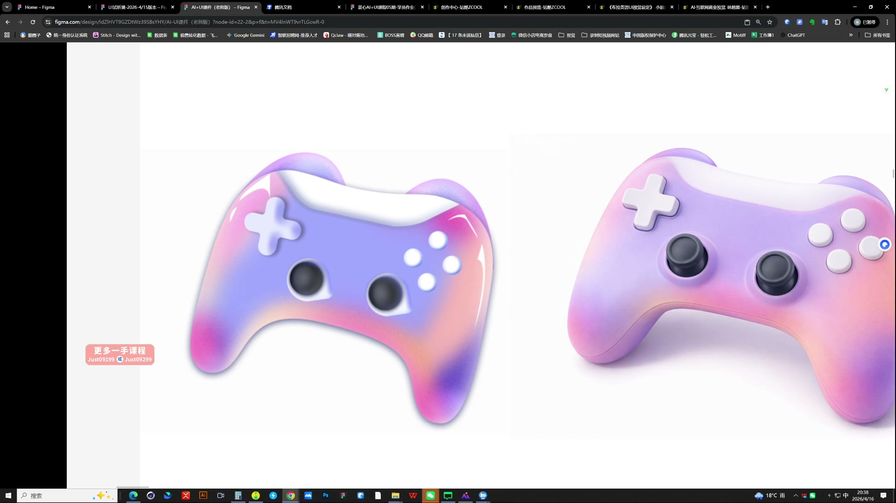
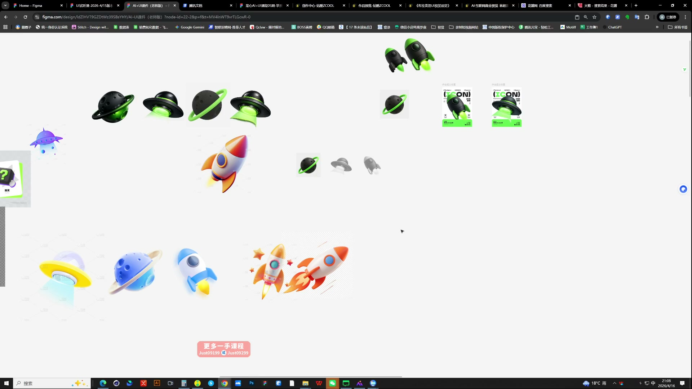
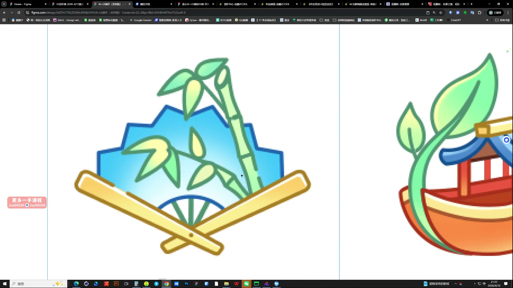

# 01 AI辅助图标设计

> **核心：找参考定方向，用透视做饱满，在成熟基础上微创新，把简单图标做精。**

原视频：1AI辅助图标设计 .mp4 ｜ 时长：02:36:55

## 必须掌握

- 四个原则：有参考、有透视、克制创新、学会精简；先保证精度，再追求创意。
- 参考解决方向；拆造型、材质、配色和视角，不能只说“高级、好看”。
- 质感图标要看得到厚度和体积，不要所有主体都只有正面平面。
- 两条生成路径：自己画结构草图＋质感参考；或直接用造型参考＋质感参考。选图时先把视角和饱满度确定。
- 微创新优先改比例、轮廓与局部结构；Q版可以放大关键部分、缩小次要部分，避免靠堆元素制造差异。
- 同一套保留共同材质与光照，只替换功能主体；缩小放回界面检查识别度。
- PS精修先拉开面与面的明暗；投影可吸取原色，用正片叠底再调透明度，避免发脏。

## 直接照做

找造型与质感参考 → ChatGPT（课中4o）生成母版 → 改比例做差异 → 同风格延展 → PS精修 → 界面验证。

**提示词骨架（按需求替换括号）：**

以图1的主体结构为基础，参考图2的材质与光照，生成[目标图标]；保持[视角/品牌色]，主体饱满，背景简洁。

## 关键画面

### 01:01:30｜参考图与生成结果的对照

观察手柄的轮廓、材质与配色如何被保留。

### 01:31:30｜同主题图标延展

把飞碟、火箭等并排检查，找出材质和角度不统一的图。

### 01:56:30｜图标风格的变化

比较立体与线面表达，先选适合产品的方向。
