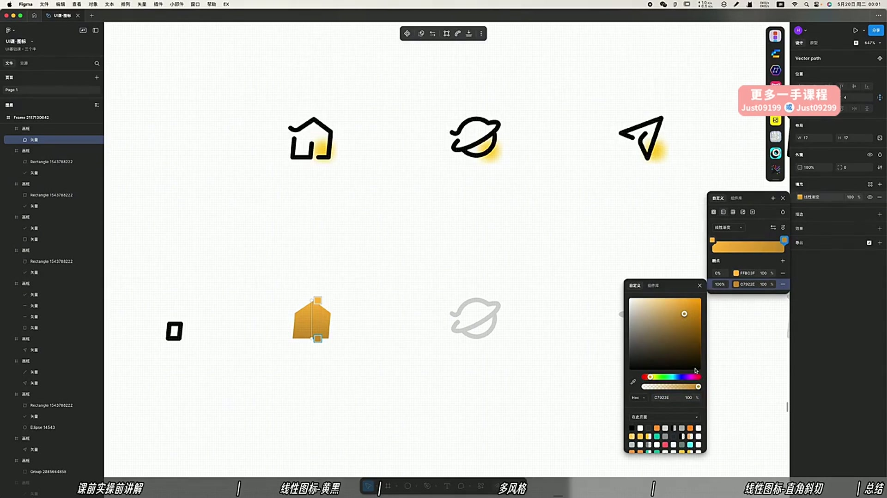
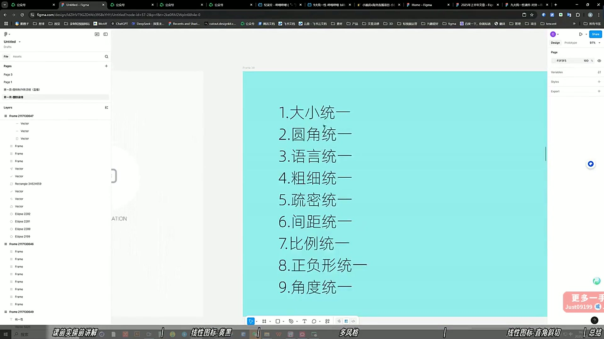
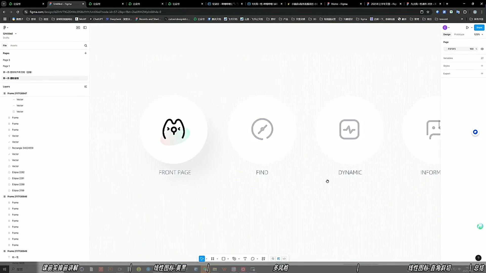

# 02 线面性图标的快速出稿方法

> **核心：从图标库找素材底子，按九大统一性精修，比从零画一套更快。**

原视频：02 线面性图标的快速出稿方法（精剪录播） .mp4 ｜ 时长：01:22:49

## 必须掌握

- 九项统一：大小、圆角、语言、粗细、疏密、间距、比例、正负形、角度。
- 选素材底子时搭配方、圆、三角等不同轮廓，统一语言，同时避免整套全是同一种外形。
- 先建立黑白骨架，确认轮廓识别度，再添加少量强调色。
- 图标要看视觉大小；同尺寸的长条形与方形，视觉重量可能不同。
- 选中和未选中状态要有清楚差异，同时保留相同的图形语言。
- 断线风格要统一断口间距；颜色比例和内部留白，也要放在同一套里比较。

## 直接照做

图标库找底子 → 调视觉大小与圆角 → 调线宽、疏密和正负形 → 加局部色 → 整套与状态检查。

## 关键画面

### 00:41:30｜线性骨架与局部强调色

强调色只承担重点，不要把每个区域都涂满。

### 00:46:30｜整套图标的九项统一

这张检查表可以直接用于交付前自查。

### 00:56:30｜底部导航的状态表达

对比选中与未选中图标，检查辨识度。
