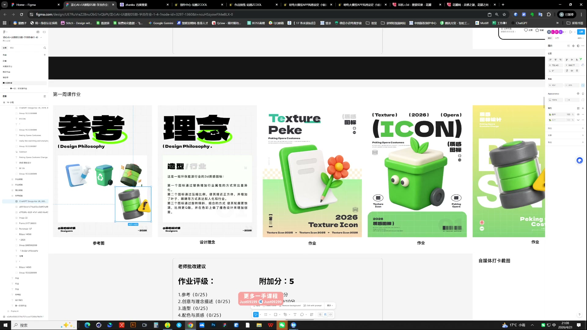
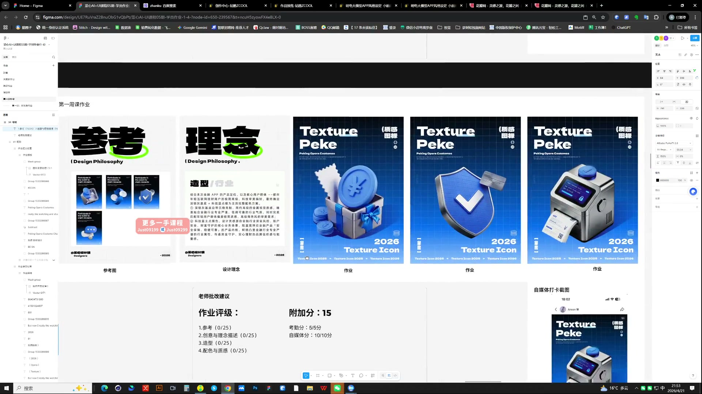

# 03 第一周作业点评｜图标的造型与材质

> **核心：评价图标先看图形本身，再看展示版式；参考、理念和结果需要对应。**

原视频：3第一周作业点评 .mp4 ｜ 时长：03:53:46

## 必须掌握

- 参考图应证明你想保留什么，设计理念要解释造型、行业与材质的选择。
- 三枚图标同尺度并排查：厚度、疏密和复杂度要接近；不要一枚是大面块，另一枚全是细碎小零件。
- 图标主体的比例、透视和细节要先修好，海报装饰解决不了本体问题。
- 去色查明暗：只有中灰会显平；用黑白灰拉开对比，主体仍要有清楚的体积与厚度。
- 展示时突出图标，避免标题、底纹和附加元素抢走注意力。

## 直接照做

看参考 → 看设计目标 → 并排查图标 → 修本体 → 调展示。

## 关键画面

### 01:11:30｜参考、理念与成品的对应关系

先看图标是否实现了所选风格，再看包装是否把优点呈现出来。

### 01:56:30｜同系列图标展示

检查色彩与材质统一，同时保留不同功能的识别特征。
