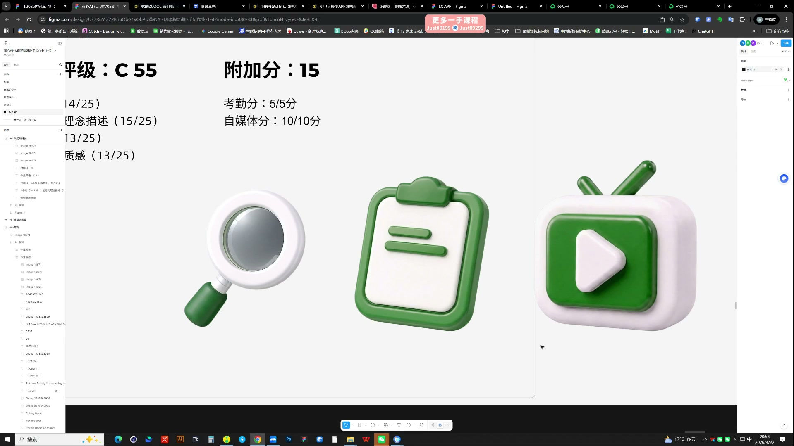
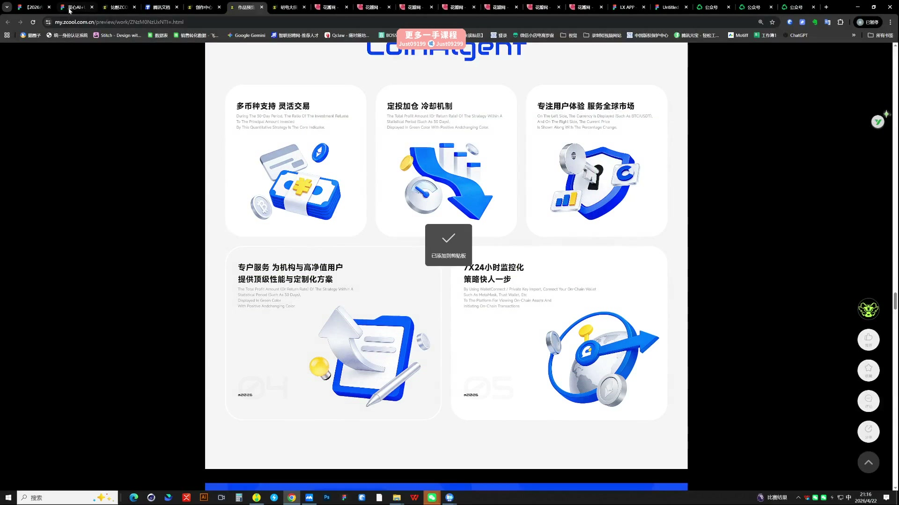

# 04 第一周作业点评续｜整套图标的一致性

> **核心：统一不是套同一颜色，而是造型、视角、材质和复杂度共同成立。**

原视频：4第一周作业点评(71-150)  .mp4 ｜ 时长：04:04:31

## 必须掌握

- 一套图标中，某一枚过于复杂或材质明显不同，会破坏整套感觉。
- 用相近的视觉体量排列图标，不能只按图片外框等比缩放。
- 参考图必须与目标有关；混用不同方向，容易得到没有统一规则的结果。
- 先解决造型表达，再调整配色与包装，按层级修改更有效。
- 基础训练先用常见的非透明、磨砂质感；先磨好造型与明暗，再尝试更难控制的特殊材质。
- 底托只能辅助统一，主体比例与材质仍需成立；组合元素保留清楚边界，用黑白灰调节多色节奏。

## 直接照做

整套并排 → 标出差异项 → 确定共同规则 → 重生成或精修偏离项。

## 关键画面

### 01:21:30｜放大查看基础图标

检查轮廓、圆角和各主体的视觉重量。

### 01:41:30｜参考系列的共同语言

观察同类图标怎样保持材质、光照与复杂度的一致。
