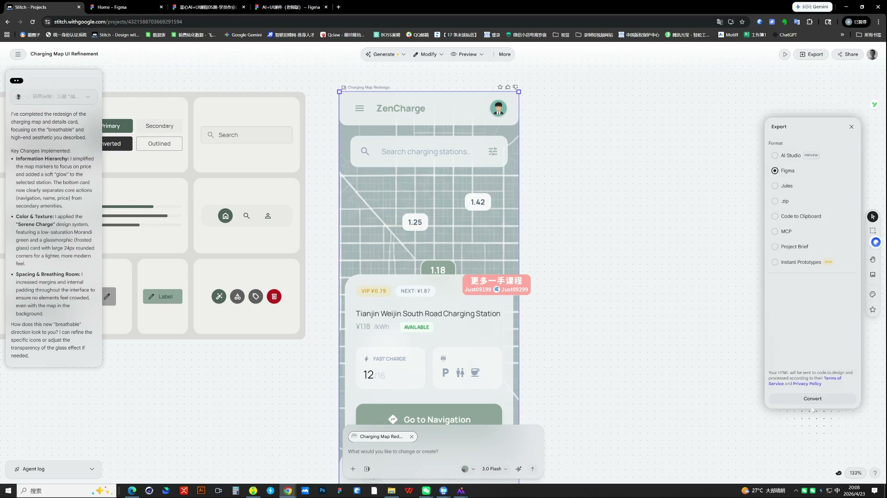
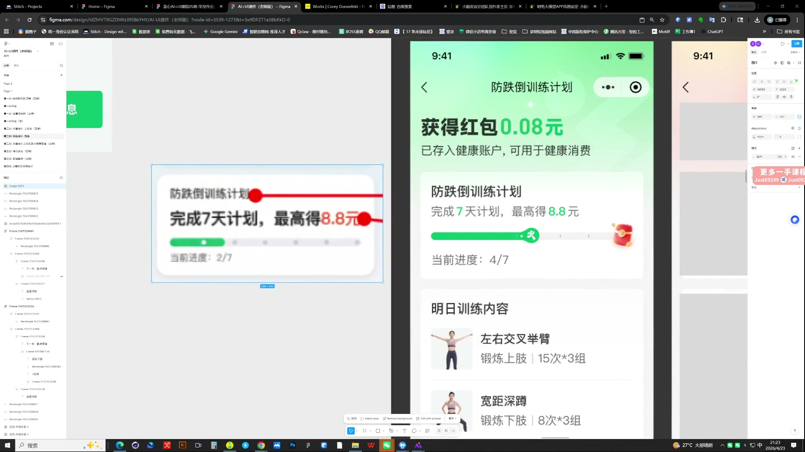
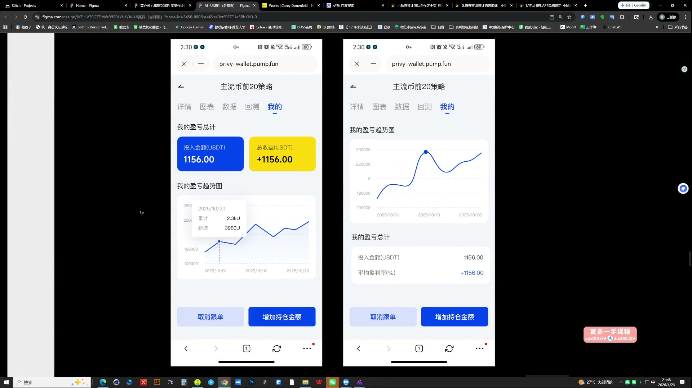

# 05 AI辅助界面设计

> **核心：先排大小容器与信息层级，再加入主形象和视觉细节。**

原视频：5AI辅助界面设计（包含作业布置） .mp4 ｜ 时长：03:00:47

## 必须掌握

- 课中先用Stitch探索页面框架；去掉颜色和装饰查布局，大容器装小容器，卡片、标签和文字分组先成立。
- 容器组织信息；主形象可用图标、卡片或图表，不必是IP；缩小后仍应明显，避免亮点过小。
- 先突出金额、进度等主数据；辅助文字、分割线和图形退后，避免装饰抢焦点。
- 间距结合圆角、内容密度与视觉重量调整，不机械套固定数值。
- 多页保持颜色和组件规则，主视觉的面积与结构形成变化；保留与背景融合的留白，增加透气感。
- 整页有问题时先拆容器定位：找最影响效果的一块优先改，不把已经成立的模块一起推翻。

## 直接照做

页面任务 → 大容器框架 → 小容器与文字排版 → 主形象 → 卡片质感 → 多页检查。

## 关键画面

### 00:11:30｜Stitch生成框架与导出

先拿AI结果检查布局和组件，再细化主形象；生成框架不等于完成视觉设计。

### 01:26:30｜任务状态的视觉表达

图形表达要帮助分清已领取与未完成状态。

### 01:51:30｜金额模块的对照

对比前后版本，观察信息焦点如何通过颜色和分组被突出。
