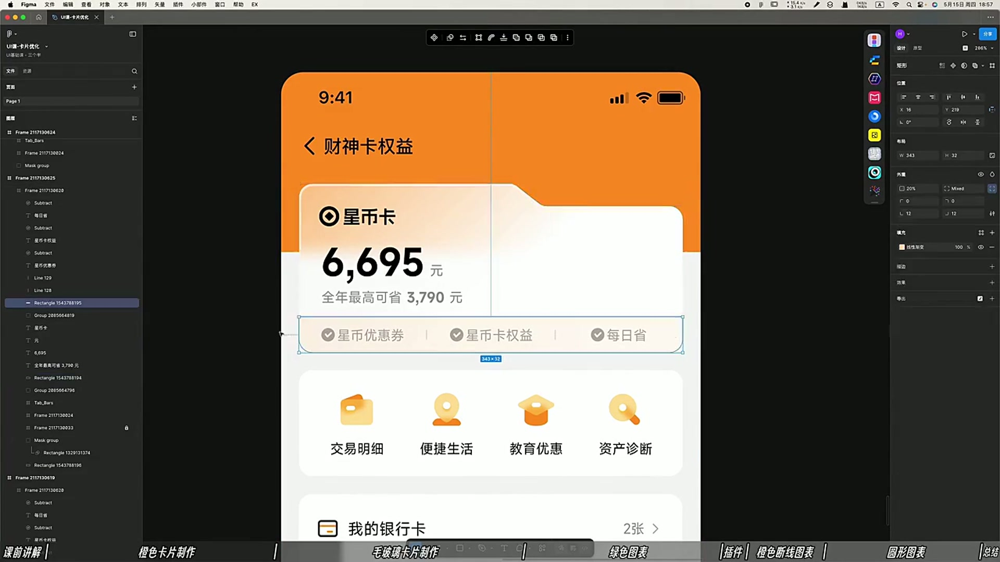
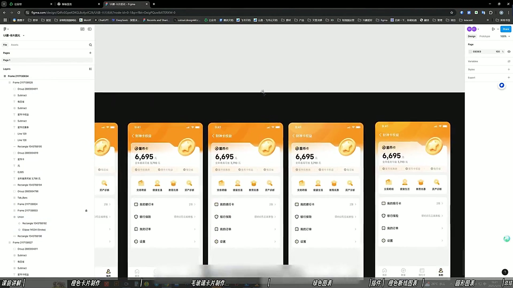
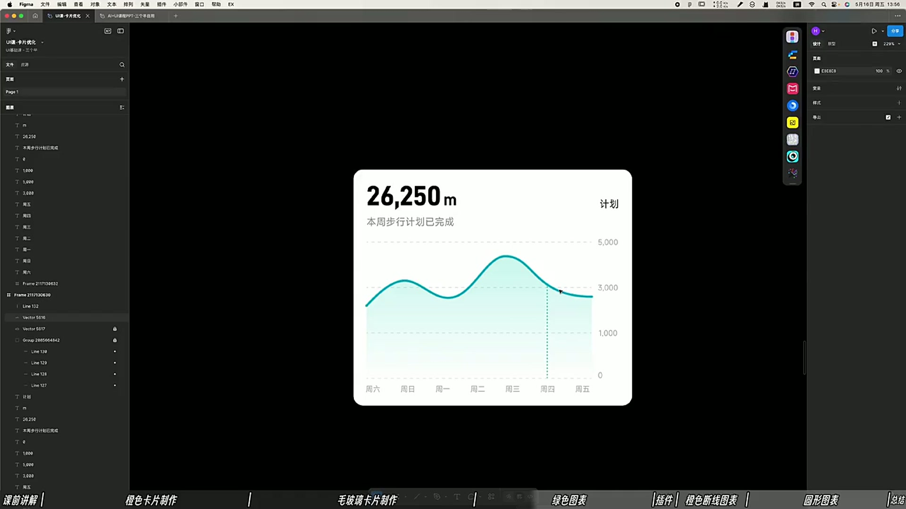

# 06 界面主形象精修实操

> **核心：主形象精修的关键是统一层次，让素材、卡片和文字真正融入同一页面。**

原视频：6界面主形象精修实操（精剪录播） .mp4 ｜ 时长：01:21:58

## 必须掌握

- 主数据先建立大小对比；辅助信息、分割线与小图形通过透明度、粗细和大小退后一级。
- 卡片用轻微渐变与细描边补质感；描边可形成边缘光，白色也可带轻微色相。
- 毛玻璃操作：给卡片添加背景模糊；课中示例约15，再对照实际背景调整。
- 主形象与卡片交叠时，检查边缘、遮挡与阅读空间；卡片的质感要与金币等主形象融合。
- 图表补气泡提示、浮层、柱形渐变与图标等有效细节；刻度、标线透明度统一，避免主次混乱。
- 多个版本并排看整体；装饰图形做不好时先不加，每个细节必须改善效果。

## 直接照做

排主数据 → 弱化辅助信息 → 加渐变与细描边 → 设置背景模糊 → 融合主形象 → 整页对照。

## 关键画面

### 00:21:30｜主形象与卡片的结合

检查形象的位置是否挤压金额和权益信息。

### 00:51:30｜多个版本并排比较

先判断整体视觉关系，再选择局部精修方向。

### 00:56:30｜数据卡片的细节调整

精修对象不只插图，也包含曲线、底色和信息对比。
