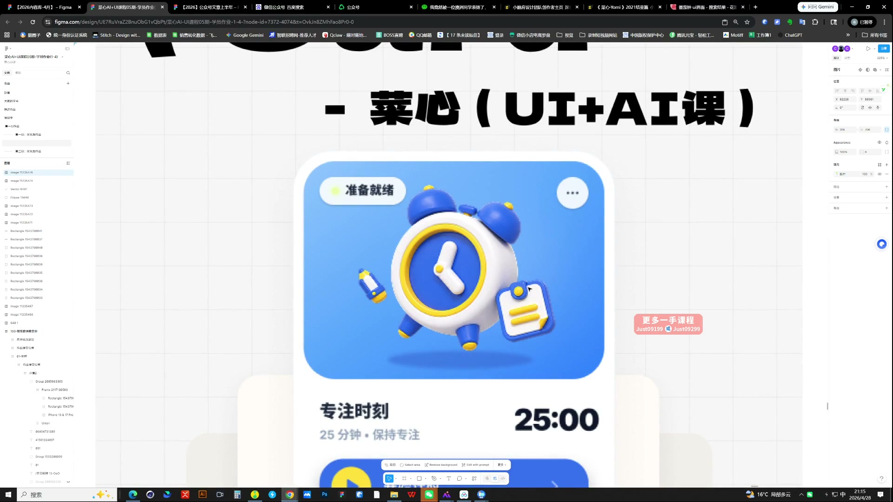
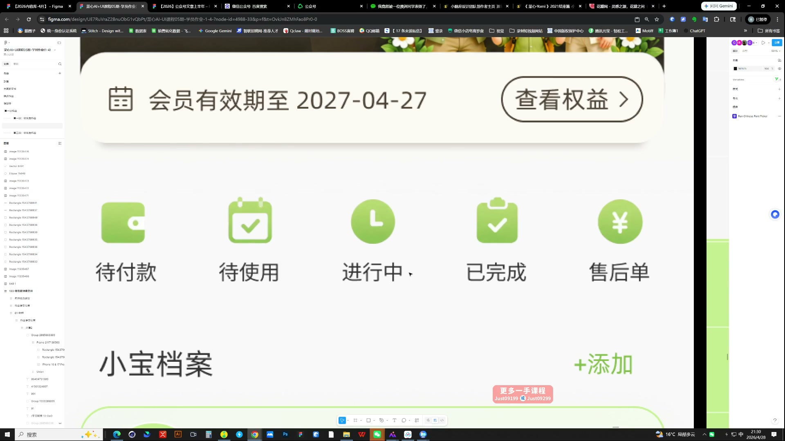
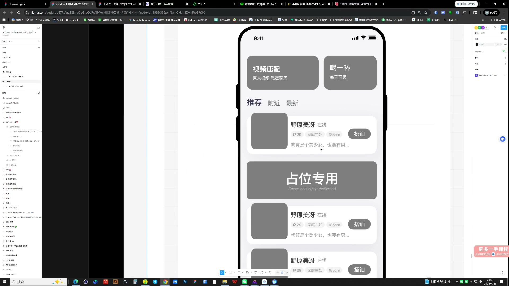

# 07 第二周作业点评｜界面主次与图标状态

> **核心：先让页面任务清楚，再让每个模块的状态、层次和风格一致。**

原视频：7第二周作业点评(71-150)  .mp4 ｜ 时长：03:14:57

## 必须掌握

- 单枚图标不够精致时，先磨一枚到位，再扩整套和界面；同时铺开容易每一块都没做好。
- 主视觉、主数据与主要操作不能同时争第一层级。
- 导航与功能图标要检查状态；选中状态的形状、颜色和背景应形成规则。
- 相似功能的图标并排检查，大小、材质与视觉重量不要各自为政。
- 把页面缩小看整体，再放大看细节；包装版式不能代替真实界面评价。

## 直接照做

看整页焦点 → 查模块分组 → 查图标状态 → 修局部 → 返回整页确认。

## 关键画面

### 01:16:30｜页面主视觉与主要数据

观察时钟形象与计时数据之间的主次关系。

### 01:31:30｜同一行功能图标

并排检查图标的重量、颜色与文字对齐。

### 01:56:30｜灰度下的信息层级

去掉色彩后，仍应能判断主要模块和操作。
