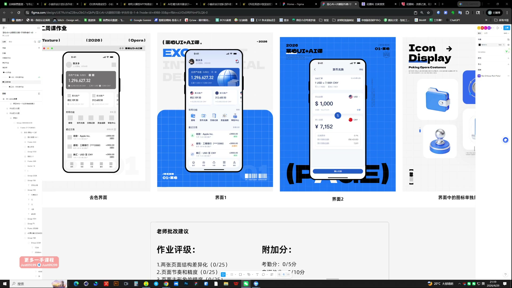
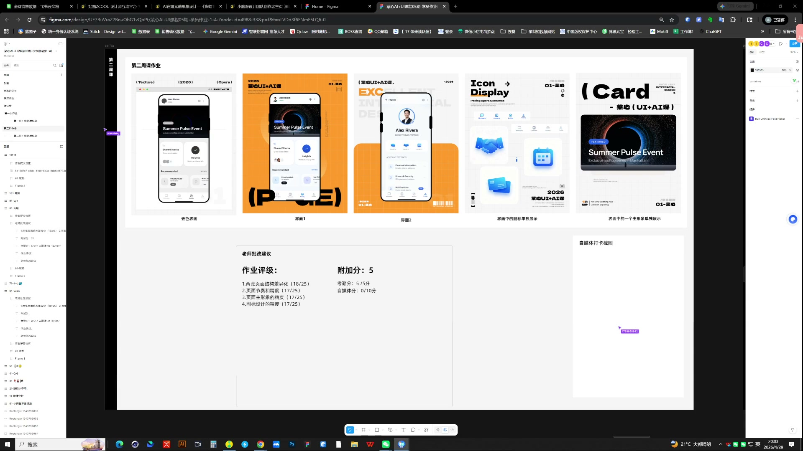

# 08 第二周作业点评｜色彩焦点与视觉节奏

> **核心：颜色集中在主要模块，其他内容退后，才能形成清楚的页面节奏。**

原视频：8第二周作业点评(1-70) .mp4 ｜ 时长：03:36:38

## 必须掌握

- 把参考放在旁边：先让一个主要模块有颜色，辅助区域用黑白灰，再逐步补色。
- 信息多时仍要有明确重心；上部已很重，下部不要又突然加入同样强的颜色。
- 图标的复杂度、间距和文字大小同时检查；一个过空、一个过密都会破坏节奏。
- 颜色和间距都要给重点让路；没有主次时先删减，不要继续往页面里添加元素。

## 直接照做

明确改版目标 → 比较前后页面 → 检查主要数字 → 统一素材与组件。

## 关键画面

### 01:21:30｜资产页面与图标展示

先看信息组织，再检查图标是否融入页面。

### 01:41:30｜原版、改版与局部组件

让改版证据对应具体的功能模块。
