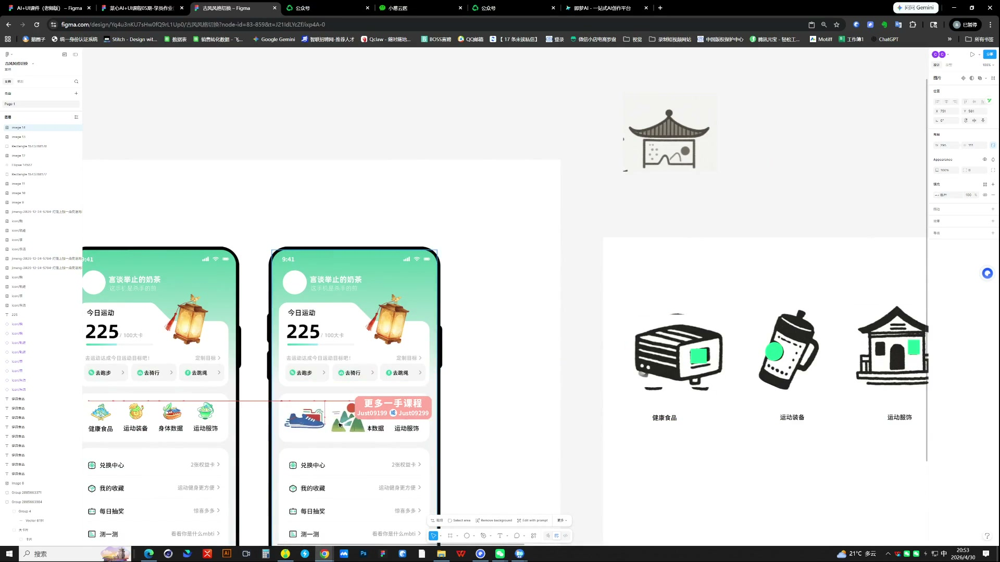
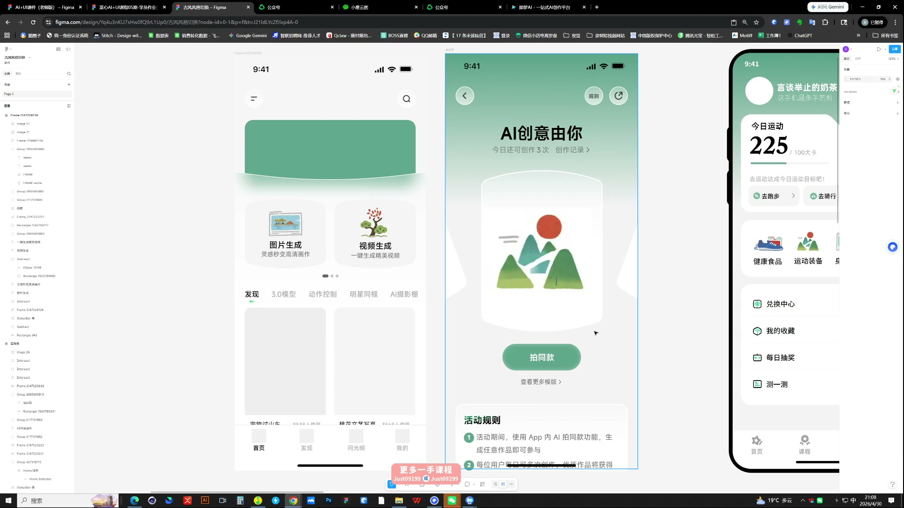
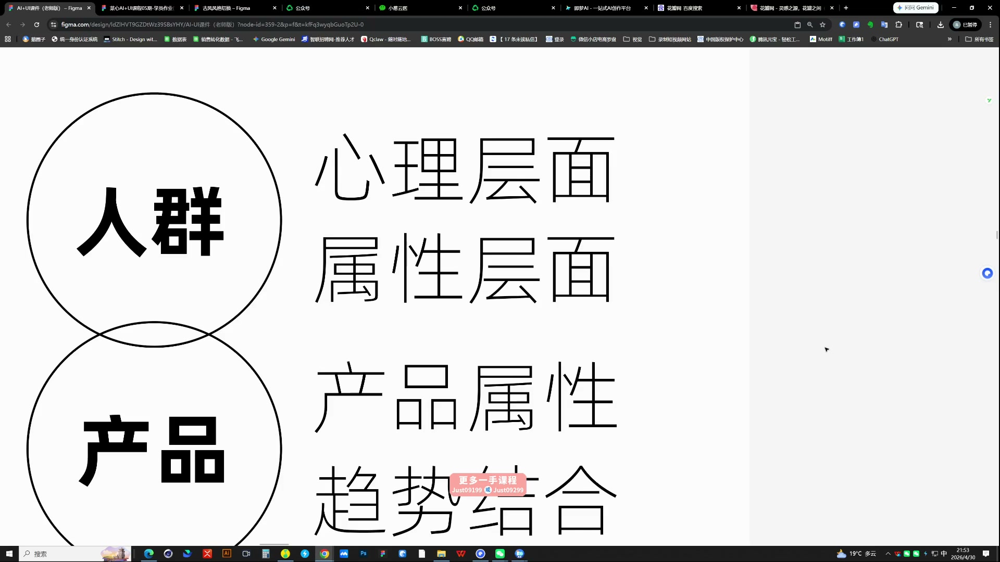

# 09 AI辅助风格设定

> **核心：改风格要改变整套视觉语言，而不是只换一个主色。**

原视频：9AI辅助风格设定（包含作业布置） .mp4 ｜ 时长：02:49:38

## 必须掌握

- 先把基础框架做好：去掉特色图标、主形象与装饰后，按钮、卡片和文字仍应舒服。
- 从人群与产品属性找关键词：需要陪伴→情绪化，游戏→像素，快速→闪电；再结合趋势，转成具体视觉方向。
- 先把参考素材拼成粗略方向，确认整体关系，再具体制作。
- 风格由色彩、字体、图标、主形象、背景与组件共同构成，不能只换主色。
- 渐变页面也需要黑白灰与颜色的比例变化；在同一页面结构上对照不同方向，再延展。

## 直接照做

基础框架 → 人群与产品关键词 → 拼参考方向 → 统一视觉语言 → 关键页面对照 → 延展。

## 关键画面

### 01:11:30｜同一界面中的风格替换

比较主形象、图标与色彩是否一起变化。

### 01:26:30｜主形象与页面方向的匹配

保证主形象与页面的图形语言相符。

### 02:11:30｜从人群与产品寻找关键词

人群的心理与属性、产品属性与趋势，共同限定风格方向。
