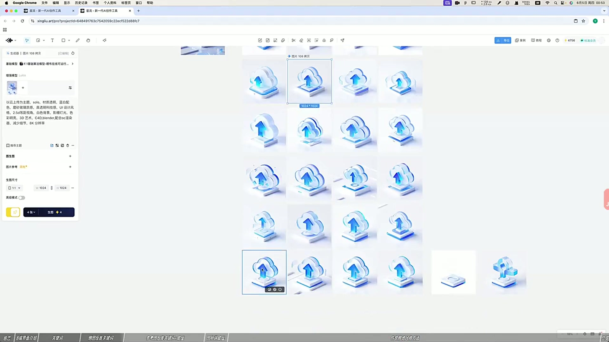
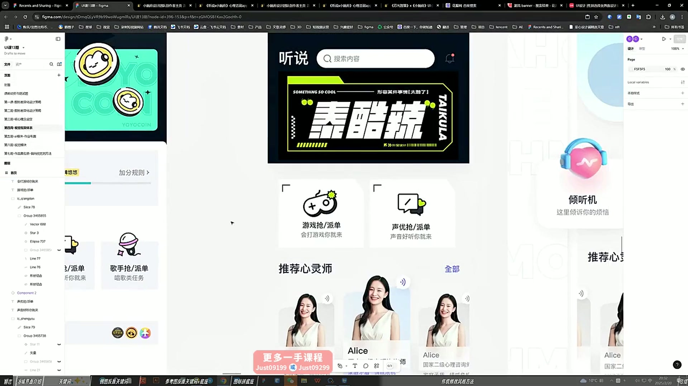
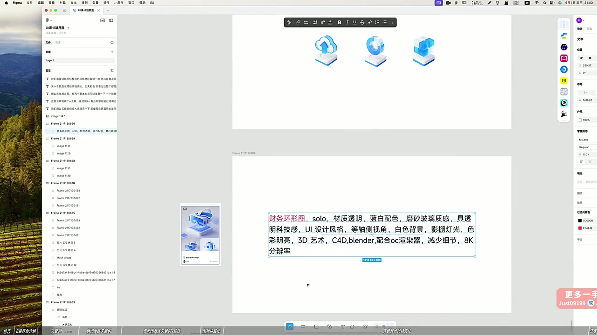

# 10 B端界面与传统风格切换实操

> **核心：先稳定素材的生成方式，再把整套视觉切换到目标风格。**

原视频：10B端界面与传统切换风格实操（精剪录播） .mp4 ｜ 时长：01:15:50

## 必须掌握

- 课中用星流分别生成主体与底座，再用4o组合、补投影；先保证造型饱满、细节清楚。
- 整套沿用同一个模型与风格描述，只替换主体词；示例用 solo 让背景更简单、便于抠图。
- 主体描述可从模型示例的生成信息取得，也可用参考图反推。
- 不需要的部分用智能擦除；智能去背景后导出PNG，再回PS精修。
- 细节微调变化较小，整体微调变化更大；也可局部重绘主体、保持底座。
- 切换风格时一起调整字体、图标、主视觉与容器；整页对照，检查2.5D视角与质感的一致。

## 直接照做

星流生成主体与底座 → 4o组合补投影 → 擦除与去背景 → PS精修 → 回填界面切换风格。

## 关键画面

### 00:11:30｜同一主体的材质生成

先确认轮廓与材质，再延展系列。

### 00:31:30｜传统与新风格页面对照

比较文字、容器和主形象共同产生的风格差异。

### 00:41:30｜同系列图标与描述词

保留统一的风格描述，只替换主体。
