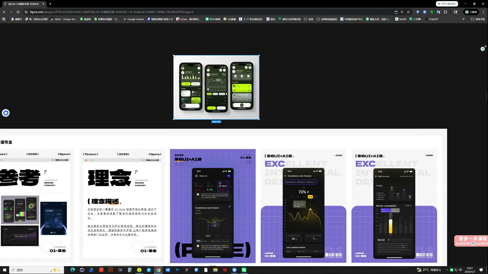
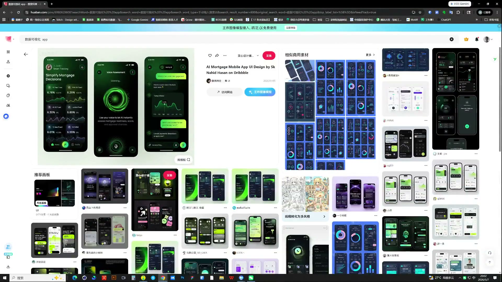
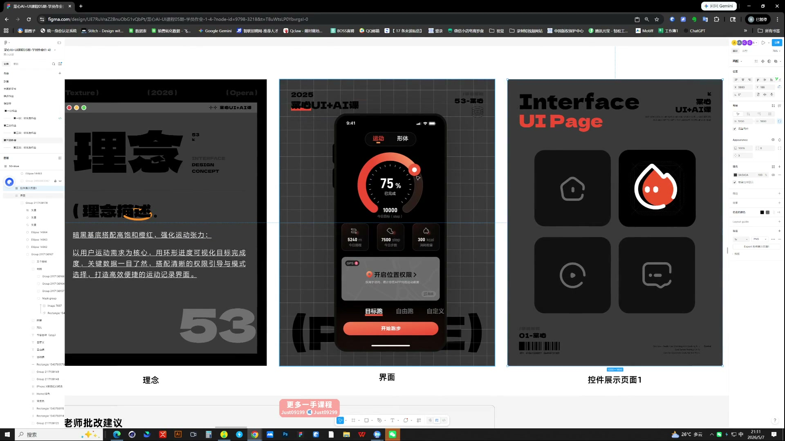

# 11 第三周作业点评｜风格一致与参考选择

> **核心：参考图要能指导改版；改完后应看得出同一套视觉规则。**

原视频：11第三周作业点评 .mp4 ｜ 时长：03:29:56

## 必须掌握

- 找与页面任务、数据类型相近的参考，拆配色、明暗和卡片规则，不只凭喜欢。
- 图标、头像与整体风格要相符；不搭的素材先拿掉，再检查页面是否更协调。
- 同色系也要补黑白灰，拉开卡片、背景与文字对比，避免整页糊成一团。
- 延展页面时仍要有重点亮出来；不能所有模块同强度、同颜色。
- 参考用于提炼规则；只做微小替换、与参考过于相似的结果，应继续发展自己的方向。

## 直接照做

找相关参考 → 拆规则 → 对照改版 → 查主次 → 查全套一致性。

## 关键画面

### 01:11:30｜原版与两种改版

对比主数据、容器与图标的风格变化。

### 01:16:30｜参考与改版方向

对照背景、亮色比例和卡片形式，而不只看主色。

### 01:36:30｜深色界面的视觉重点

检查高对比区域是否对应最重要的信息。
