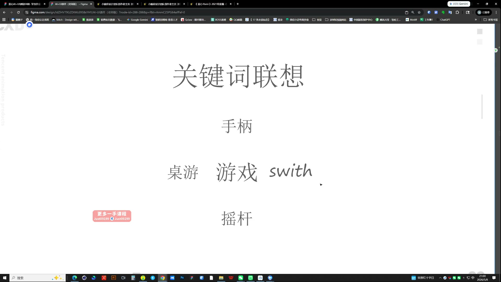
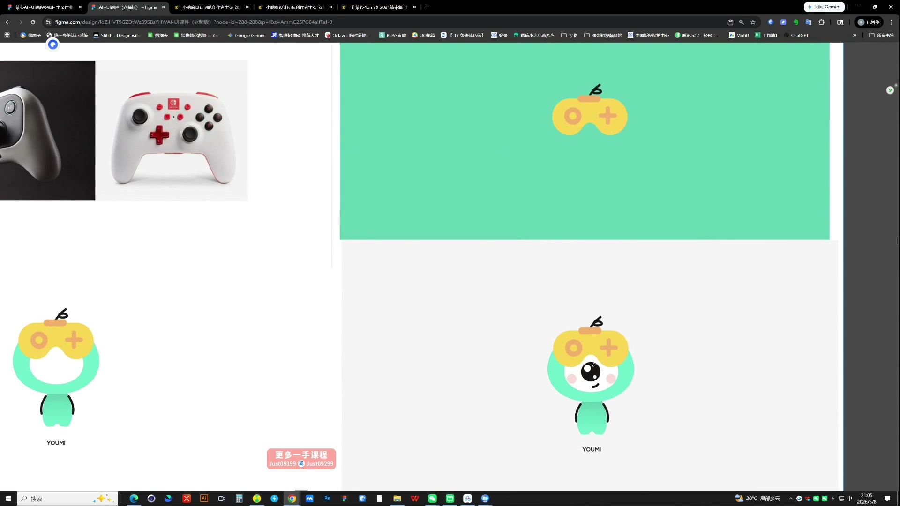
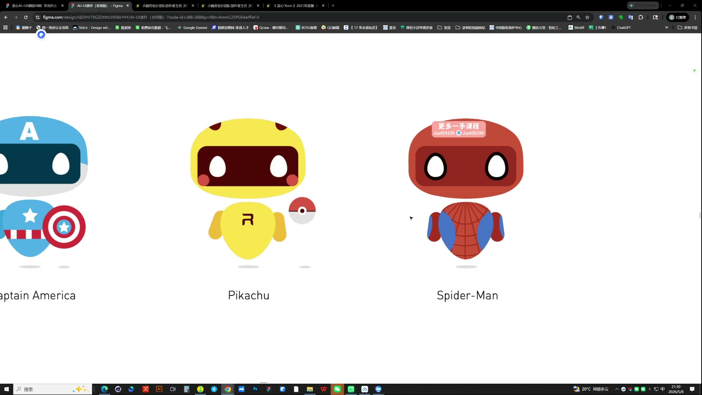

# 12 AI辅助IP设计及延展

> **核心：先把IP的识别特征设计清楚，再延展动作、表情和场景。**

原视频：12AI辅助IP设计及延展（包含作业布置） .mp4 ｜ 时长：03:11:33

## 必须掌握

- 基础设定先落到具体物体：组合、象征或拟人化；关键词不能只有“可爱、年轻”等形容词。
- 用圆、方、三角概括简洁饱满的头身，结构完整；固定比例、五官和标志配件，先定母版再延展。
- 配色先试黑白灰加少量点缀色；保留完整身体更方便后续换装和动作延展。
- 场景延展：让AI反推参考画面的前景、中景、背景结构，再把中景主体替换为自己的IP。
- 角色太小时，明确要求前移、放大占画面比例；多余门框、留白等问题逐项改。
- 动作与场景都对照母版特征，最后放回UI检查辨识度和视觉重心。

## 直接照做

具体形象设定 → 固定母版 → 动作/换装 → 参考场景拆三层 → 替换角色 → 局部修正 → UI应用。

**提示词骨架（按需求替换括号）：**

保留参考场景的前景、中景、背景构图，将中景角色替换为图1的IP；保持角色特征，调整为[位置/画面占比]。

## 关键画面

### 01:21:30｜关键词联想

从手柄联想到游戏、桌游和摇杆，把主题变成可见的设计元素。

### 01:26:30｜造型中的主题特征

观察手柄元素如何进入角色的识别结构。

### 01:51:30｜同一基础形象的不同延展

变化可以丰富，但核心轮廓与角色识别要保留。
