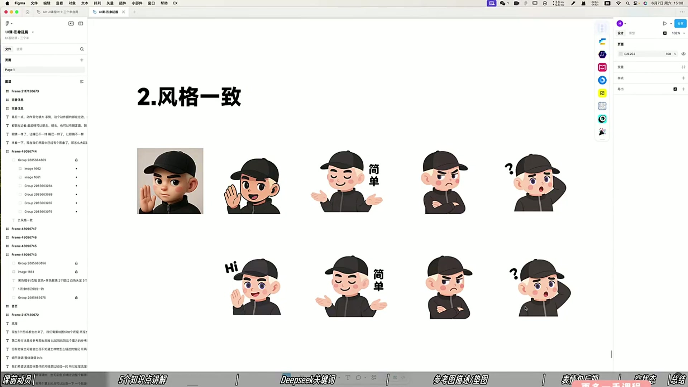
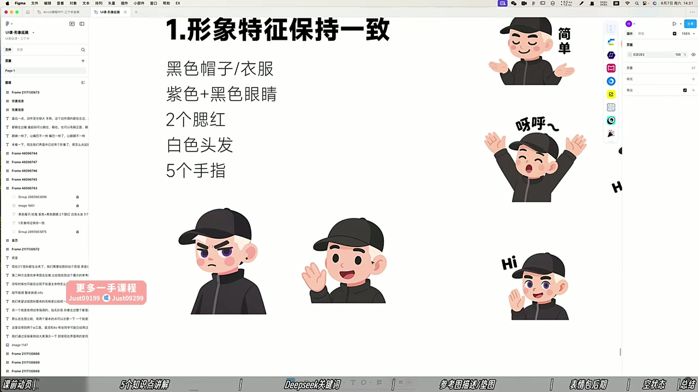
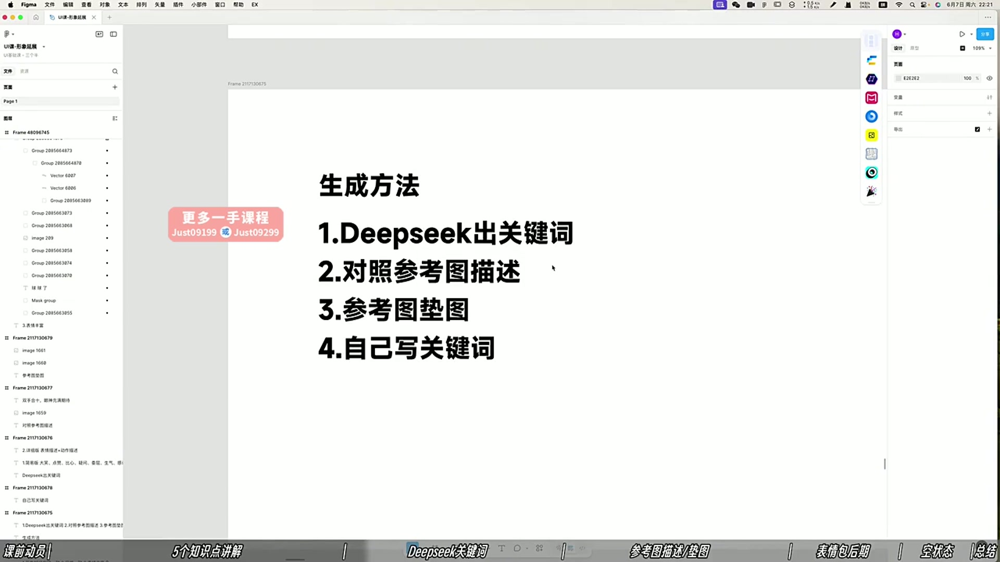

# 13 人物IP延展

> **核心：特征保持一致，表情、视角和动作要丰富。**

原视频：13人物ip延展（精剪录播） .mp4 ｜ 时长：02:26:37

## 必须掌握

- 固定角色特征：帽子、衣服、眼睛、腮红、发色；手指等结构细节也要检查。
- 统一风格：不要混用3D、描边和无描边；手部比例也要符合角色的Q版程度。
- 表情不能复制粘贴；眼睛相近时，可用嘴形、眉毛等拉开差异。
- 视角可左右、居中、俯仰变化；选择能保留角色特征的角度。
- 动作变化要够大；装饰星星等可后期加，避免提示词让后续每张都重复出现同一装饰。
- 四种生成路径：DeepSeek出关键词、描述参考图、参考图垫图、自己写关键词。
- 课中用4o：上传母版IP＋九组动作表情词，要求全身、纯白背景、风格不变；再按五项标准筛选。

## 直接照做

固定母版 → 写动作＋表情 → 生成 → 对照特征 → 补表情与视角差异 → 精修。

**提示词骨架（按需求替换括号）：**

以图1为角色母版，保持五官、配件、颜色和画风，生成[动作＋表情]；全身、纯白背景；动作变化明显，身体比例不变。

## 关键画面

### 00:06:30｜混合风格与统一风格对照

让每张图看起来属于同一个角色系统。

### 00:46:30｜角色特征的一致性清单

把这一清单用于每张延展图的验收。

### 00:56:30｜四种延展生成方法

按参考素材和已有描述的情况选择路径。
