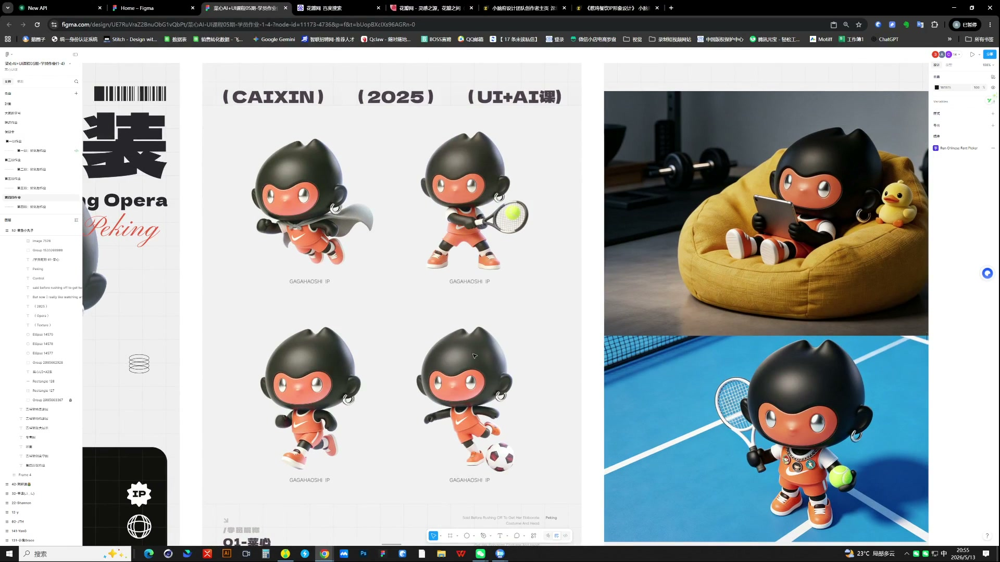
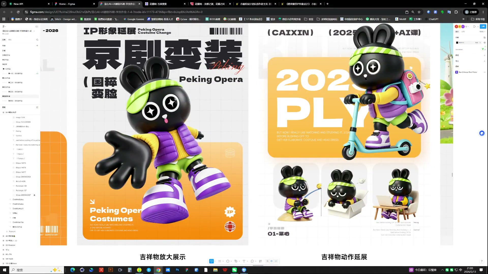
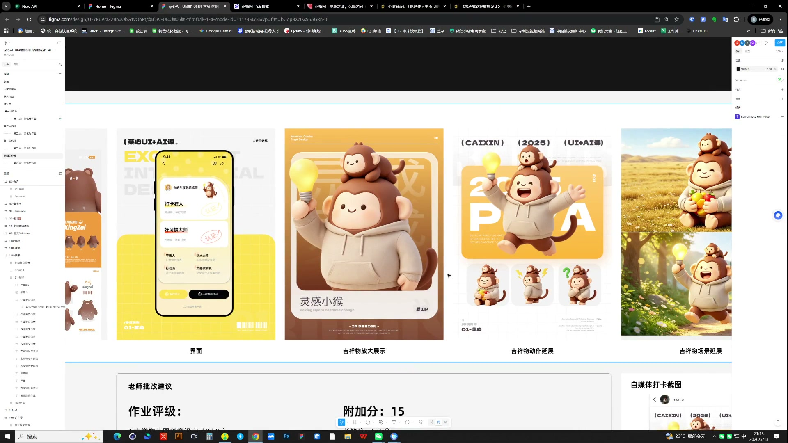

# 14 第四周作业点评｜IP辨识度与延展

> **核心：每张延展图都应该认得出同一个角色，同时表达不同的情绪和行为。**

原视频：14第四周作业点评 .mp4 ｜ 时长：03:02:25

## 必须掌握

- 创意或特征至少有一项清楚：主题元素应一眼可认，避免多个表情和配件堆在角色上。
- 母版先固定头身比、手脚长度与形状；延展时逐张对照，不能突然长腿或变成另一种体型。
- 表情与身体动作拉开差异；只有站姿换场景，活力不够。
- 场景做减法，统一角色在画面中的占比，让整套焦点集中。
- 素材精度与角色年龄气质要匹配产品；包装不能替代基础造型的修正。

## 直接照做

对照母版 → 查特征 → 查动作和表情差异 → 查场景融合 → 修偏离项。

## 关键画面

### 01:16:30｜动作与场景两种延展

区分角色自身的动作变化与场景中的使用效果。

### 01:21:30｜同一角色的多动作展示

检查配件与身体比例是否跟随动作保持一致。

### 01:36:30｜基础形象与延展的完整展示

让读者一眼知道母版是什么、延展了什么。
