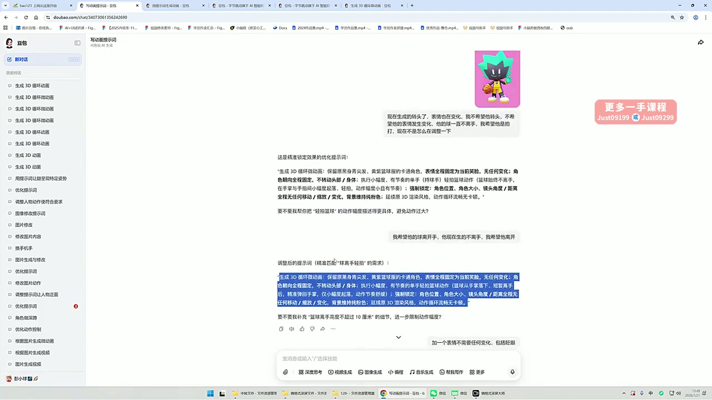
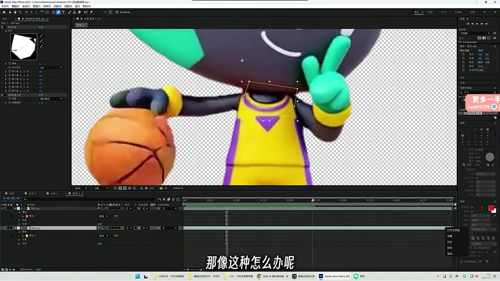
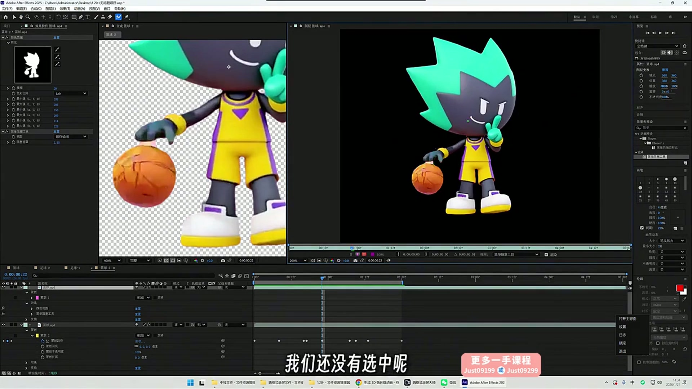

# 15 吉祥物动态生成

> **核心：用AI做动作，先锁定表情与镜头；生成后再处理背景和边缘。**

原视频：15吉祥物动态生成（精简录播） .mp4 ｜ 时长：00:46:08

## 必须掌握

- 背景色选角色身上没有的颜色，避免后期抠像时连角色一起去掉。
- 课中用豆包先润色提示词，再选择视频生成、上传角色图；明确哪只手或脚动，哪些部分不动。
- 特色眼睛、嘴巴容易被改掉，明确‘表情全程不变’；镜头、位置、大小也要固定。
- 镜头漂移可用首尾截图反馈；成片只有中段合格时先截取可用部分，不必强求整段都用。
- 拍球等动作要检查真实关系：球应离手、落下和反弹，不能始终与手绑定。
- AE后期：用Keylight去背景；黑边可用简单阻塞工具收缩遮罩，放大复查边缘。

## 直接照做

选不冲突的背景色 → 豆包生成与修改动作 → 筛可用片段 → AE Keylight抠像 → 简单阻塞修边。

## 关键画面

### 00:16:30｜提示词的逐轮修正

动作、表情与镜头分别约束，出现问题就针对一项改。

### 00:26:30｜抠像后的边缘检查

放大检查手臂和背景接壤处，避免残留底色。

### 00:31:30｜透明背景与合成预览

在不同背景下检查角色边缘是否干净。
