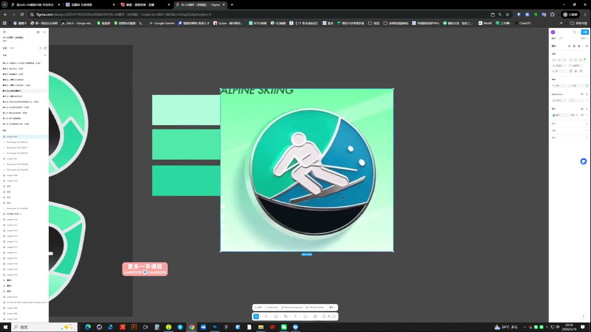
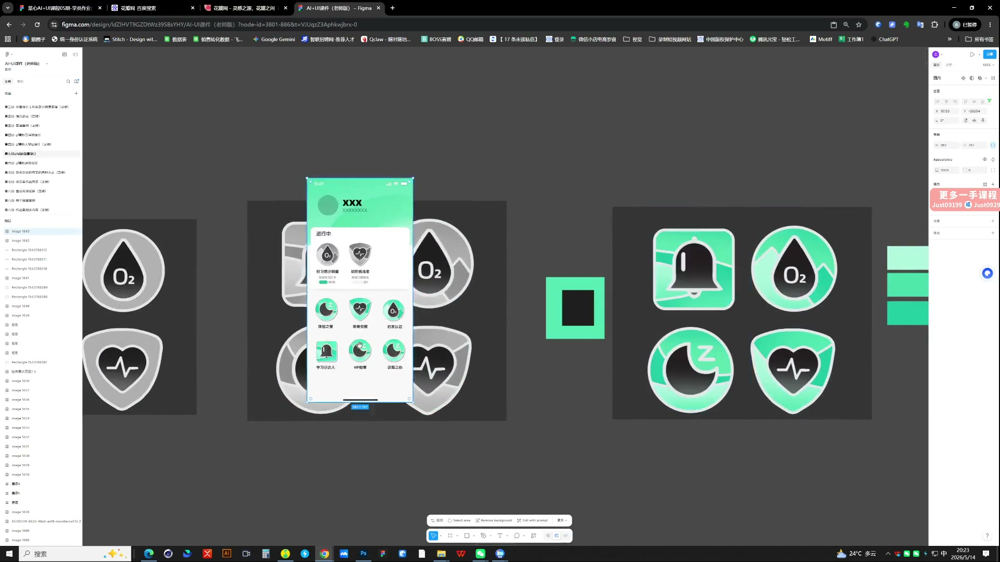
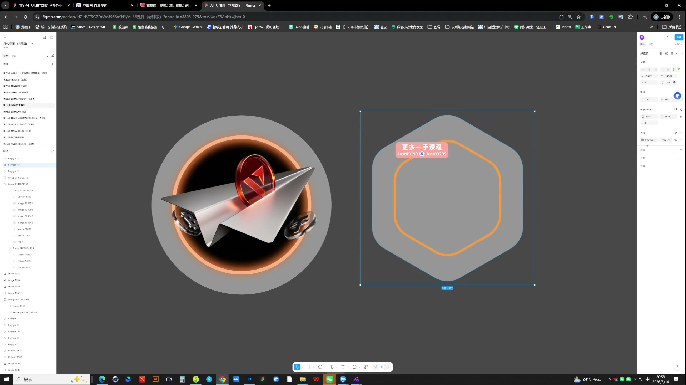

# 16 AI辅助徽章风格设定

> **核心：徽章要同时设计主体和底板，先确立母版，再形成一套规则。**

原视频：16AI辅助徽章风格设定（包含作业布置） .mp4 ｜ 时长：02:33:35

## 必须掌握

- 先看页面的颜色与调性，再选徽章风格；理性的工具页面，不必强塞热闹的装饰。
- 底板与主体是两个重点：可用圆、方、盾牌等轮廓，主体表达具体含义。
- 先画简单的线性或平面结构；把结构图与材质参考一起交给4o，指定保留结构、参考另一图的质感。
- 颜色保留层次，轮廓可以变化；不要每枚完全重复，也不要失去共同规则。
- 先做一枚成立的母版，再延展整套并放回界面检查。

## 直接照做

看页面调性 → 画主体与底板 → 找材质参考 → 4o转换质感 → 调层次 → 延展并验证。

**提示词骨架（按需求替换括号）：**

保留图1的主体、底板结构与视角，参考图2的材质和光照生成徽章；不要改变主体含义。

## 关键画面

### 00:21:30｜完整徽章中的主体与底板

看主体、金属边和背景之间的层次。

### 00:26:30｜同风格的徽章组合

用统一底板与品牌色把不同含义组织成一套。

### 00:56:30｜底板与主体的分别调整

先控制结构，再处理材质与细节。
