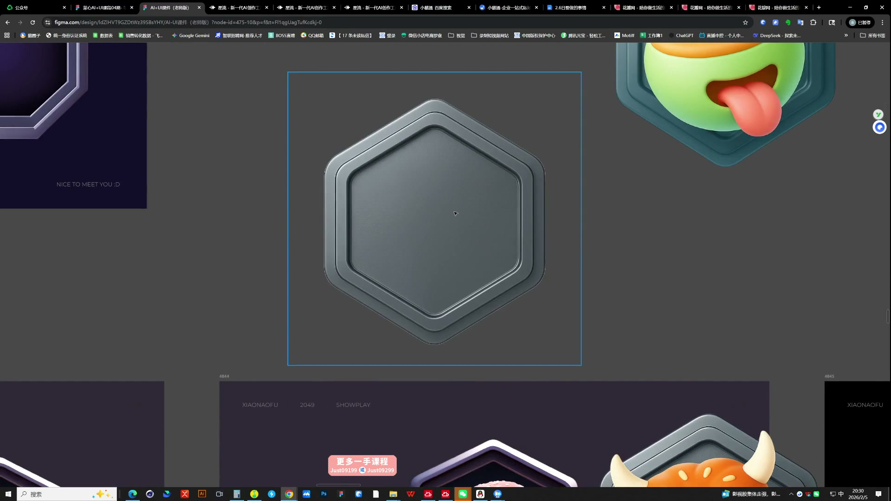
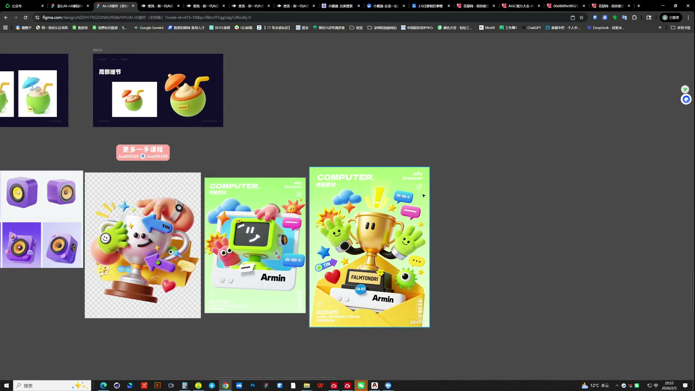

# 17 AI辅助徽章设计体系

> **核心：用共同的底板、视角和材质建立体系，让主体表达不同的成就含义。**

原视频：17AI辅助徽章设计体系 .mp4 ｜ 时长：02:35:15

## 必须掌握

- 先精修单体：比例、设计感与细节没到位时，不要急着延展背景或包装；先把一个亮点磨透。
- 本课优先把三个平行徽章做精、做统一；等级递进放到后面，不能替代当前的风格与精度训练。
- 共同底板负责统一，主体负责差异；检查主题与图形是否一一对应。
- 先比较同类素材的结构与材质，选定后延展，不要把探索图直接拼成一套。
- 主体有绝对重心，其他元素用大小、遮挡和前后关系拉开；可适当突破底板边界，但不让每个元素都抢出来。

## 直接照做

梳理徽章含义 → 定共同底板 → 生成主体 → 统一视角与材质 → 检查体系 → UI应用。

## 关键画面

### 00:31:30｜底板与主体的结构关系

共同底板不能掩盖每枚徽章的不同含义。

### 00:46:30｜非等级徽章的主题表达

麦克风、耳机和音乐符号共同表达主题；元素需要有主次。

### 00:56:30｜系列素材与应用展示

体系应在单枚、整套和应用场景三个尺度都成立。
