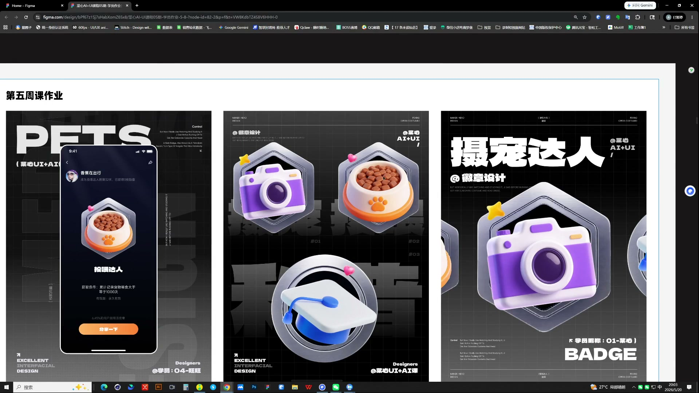
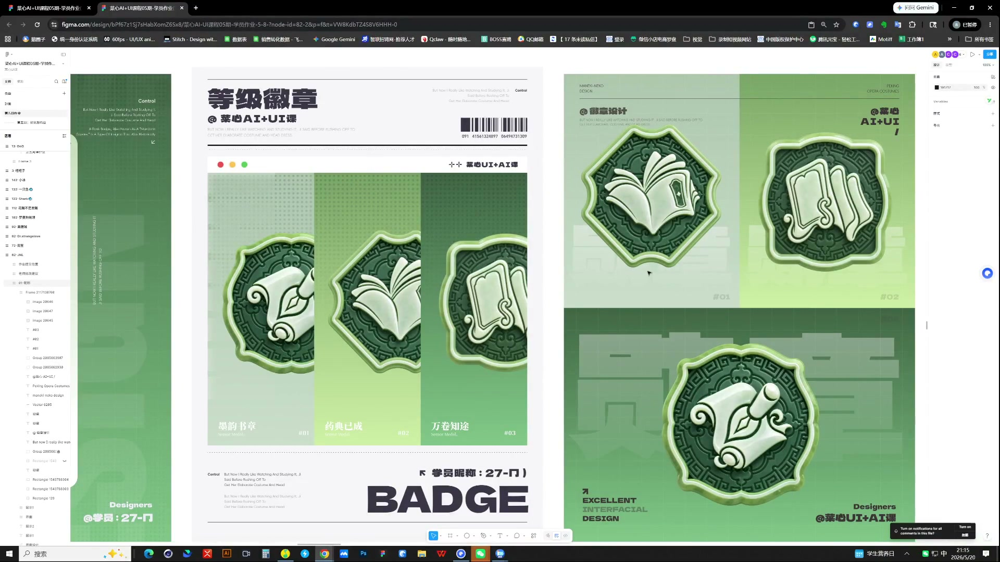
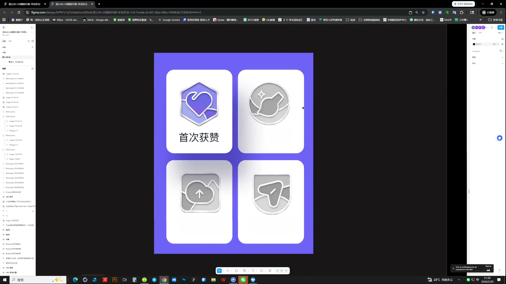

# 18 第五周作业点评｜徽章体系与状态

> **核心：徽章本体、整套风格和获得状态，都要一起检查。**

原视频：18第五周作业点评 .mp4 ｜ 时长：03:32:05

## 必须掌握

- 先有结构底图，再生成质感；主体可以分开生成，底板和卡片尽量自己控制。
- 整套检查视觉体量、浮空角度、色彩与细节程度，不留一枚明显偏弱的图。
- 同类色之间补过渡或黑白灰；颜色简洁时，造型要有足够细节或清楚创意。
- 深色页面同样要降层级：未选中、未获得状态退后，主要状态清楚，不要所有文字同亮。
- 先修本体与主体、底板的层次，再处理背景与包装。

## 直接照做

查单枚结构 → 查整套规则 → 查获得状态 → 查界面应用。

## 关键画面

### 01:11:30｜同一套徽章的展示

检查底板、主体体量和材质是否形成共同规则。

### 01:36:30｜具有不同轮廓的系列

轮廓可变化，但图形语言和细节程度仍需一致。

### 01:51:30｜获得与未获得状态对照

对比状态强弱，同时检查未获得状态的辨识度。
