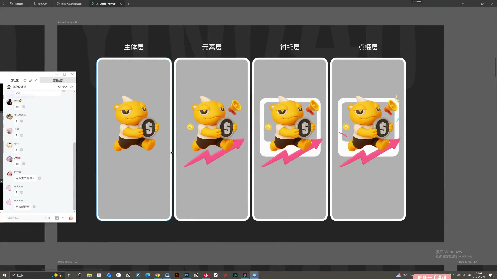
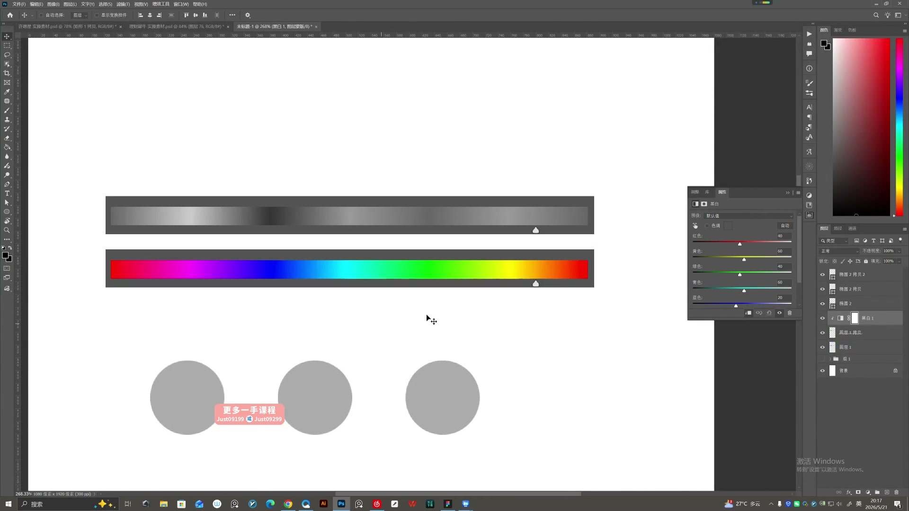
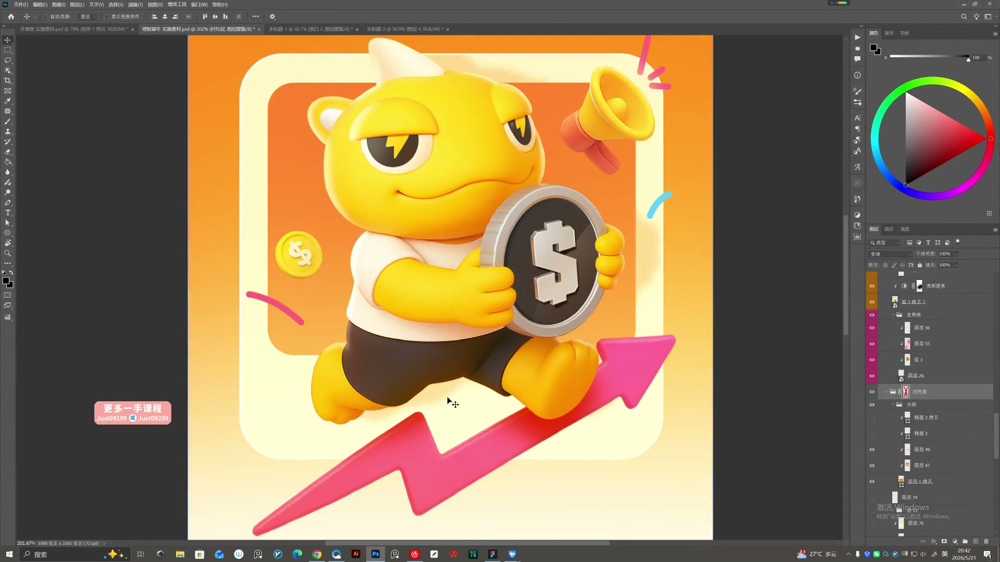

# 19 AI辅助运营视觉设计

> **核心：用四层构图组织画面，再用明暗关系拉开主体与背景。**

原视频：19AI辅助运营视觉设计 .mp4 ｜ 时长：02:11:26

## 必须掌握

- 四层构图：主体层、元素层、衬托层、点缀层；先主体，再逐步补画面。
- 辅助元素绕主体组织，大小、形状和前后穿插有变化；面积和对比不能抢过主体。
- 同类或邻近颜色先组织背景，渐变补过渡色；转灰度后，主体仍应突出。
- 强化视觉的三种办法：光照、造型、质感；可结合使用，但都要服务阅读顺序。
- 重点位置先点亮，光线按方向自然衰减；边缘光、地面投影与倒影帮助图标融入容器。
- PS统一颜色、边缘、阴影和位置；从主视觉往下阅读时，光效引导到文字与按钮。

## 直接照做

确定主题 → 放主体 → 加辅助元素 → 建衬托结构 → 加点缀 → 灰度检查 → 精修。

## 关键画面

### 00:06:30｜四层构图的逐步增加

从左到右看主体、元素、衬托与点缀怎样分别发挥作用。

### 00:21:30｜明暗与色相的分别检查

用灰度与亮度梯度判断关系，不能只靠色相区分主体和背景。

### 00:46:30｜主体与衬托层的关系

箭头、框架和辅助元素围绕主体组织，不应盖过主角。

### 01:21:30｜光效让图标融入内容卡片

星形图标的底部光与投影联系背景，卡片边缘光补体积，不只在下方加一个常规阴影。
