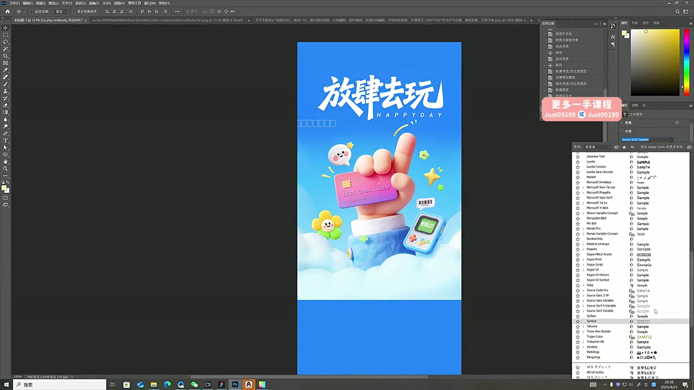
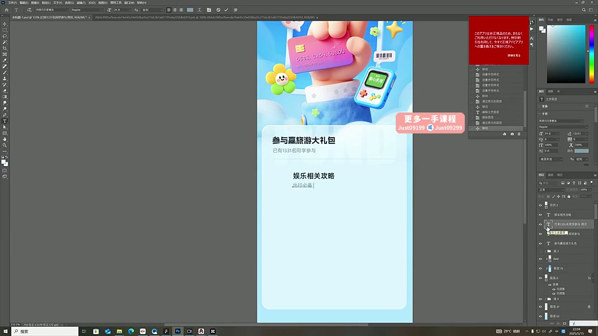
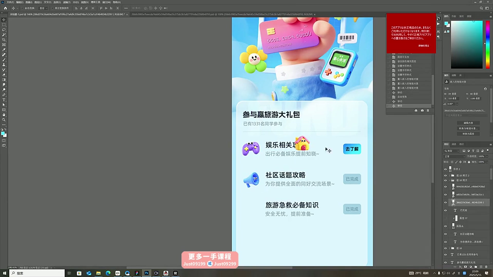

# 20 视觉运营界面设计

> **核心：把主视觉延展成可阅读、可操作的活动页面。**

原视频：20视觉运营界面设计 .mp4 ｜ 时长：00:47:42

## 必须掌握

- 课中用星流生成较干净的主画面，即梦生成辅助元素与标题字；先分别做好，再组合。
- 辅助元素可单独生成和抠出；把更精致的表情、花朵、游戏机替换进主画面。
- 标题提示词描述内容、排布、粗细、转折与连接；生成后仍要修边和调整排版。
- 用渐变延展背景、留出标题空间；轮廓光与接触投影帮助素材融合。
- 主视觉向下用内容容器承接，活动任务统一名称、说明与状态，保证可读可操作。

## 直接照做

星流生成主图 → 即梦生成元素与标题 → 抠图与修边 → 补轮廓光和投影 → 延展背景 → 排活动内容。

## 关键画面

### 00:16:30｜主视觉与标题

先建立主题和第一视觉焦点。

### 00:26:30｜内容容器承接主视觉

检查上下衔接和标题、说明的层级。

### 00:31:30｜活动任务的行结构

图标、名称、说明、状态形成可复用规则。
