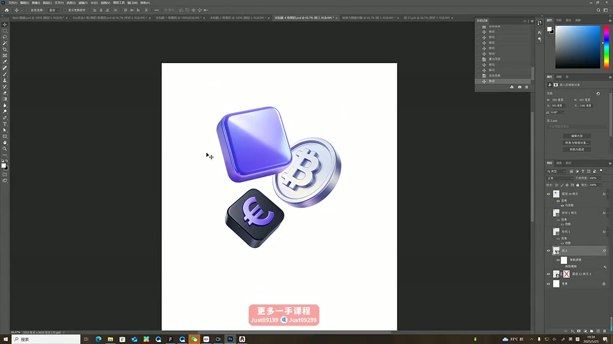
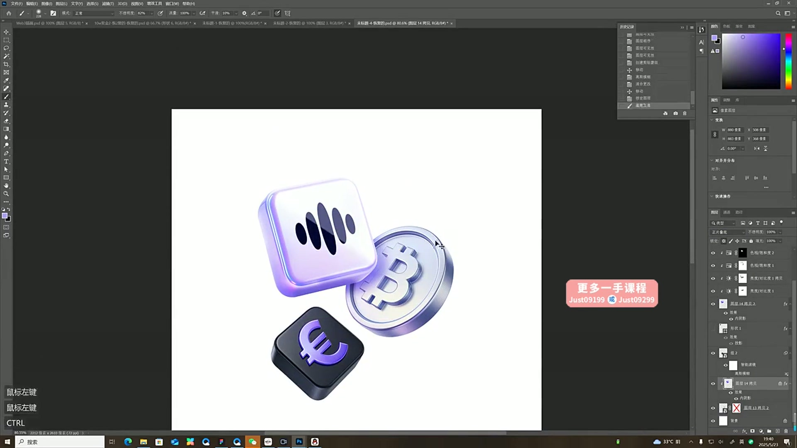
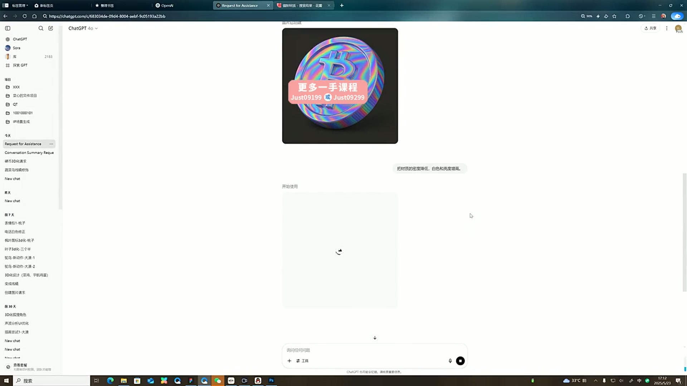

# 21 B端风格设计

> **核心：先画结构，用4o生成与更换材质，再到PS组合精修B端卡片。**

原视频：21B端风格设计  .mp4 ｜ 时长：02:47:58

## 必须掌握

- 自己先画基础图形和组合结构，再让4o按现有角度3D化，减少对结构的失控。
- 材质不对时另给材质参考，明确替换材质；颜色、反光和细节密度可分别调整。
- 多个元素分别生成，确保角度、颜色与质感共同成立，再组合成主视觉。
- 标志嵌入先明确哪张是标志、哪张是承载对象；AI失败时，在PS用透视变形贴合，再补阴影与边缘光。
- 不同面分别控制明暗与反光，用蒙版限制提亮范围；投影与光源一致，避免整体提亮后糊在一起。

## 直接照做

画基础结构 → 4o 3D化 → 参考图替换材质 → 分别生成元素 → PS嵌标志与组合 → 制作卡片。

**提示词骨架（按需求替换括号）：**

保留图1的造型和角度，将材质替换为图2的质感；只调整[颜色/反光/细节密度]，其余结构不变。

## 关键画面

### 01:11:30｜多个业务元素的组合

检查各主体的角度、前后关系与视觉重量。

### 01:16:30｜品牌标志进入主形象

品牌符号应清晰可辨，并与材质融合。

### 01:41:30｜虹彩材质的品牌主形象

保留结构更换材质后，复查反光、轮廓与品牌符号。
