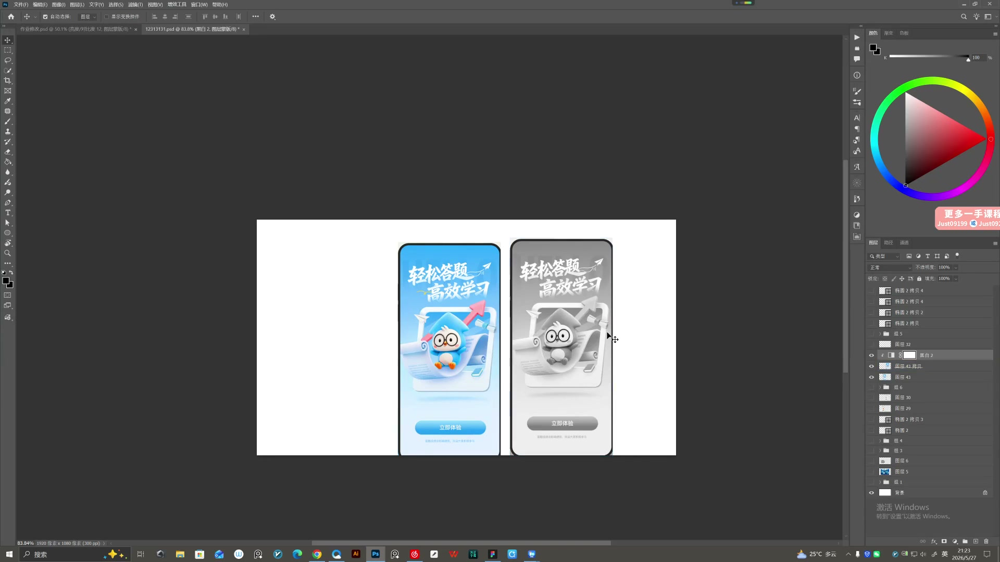
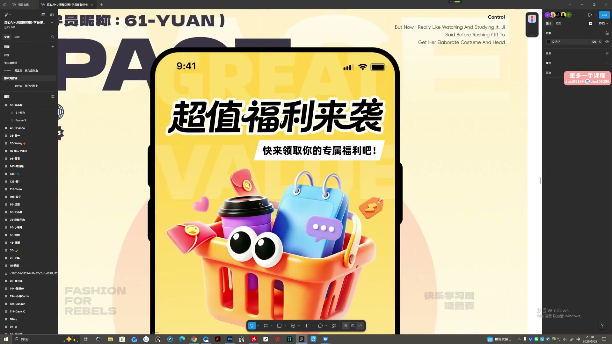
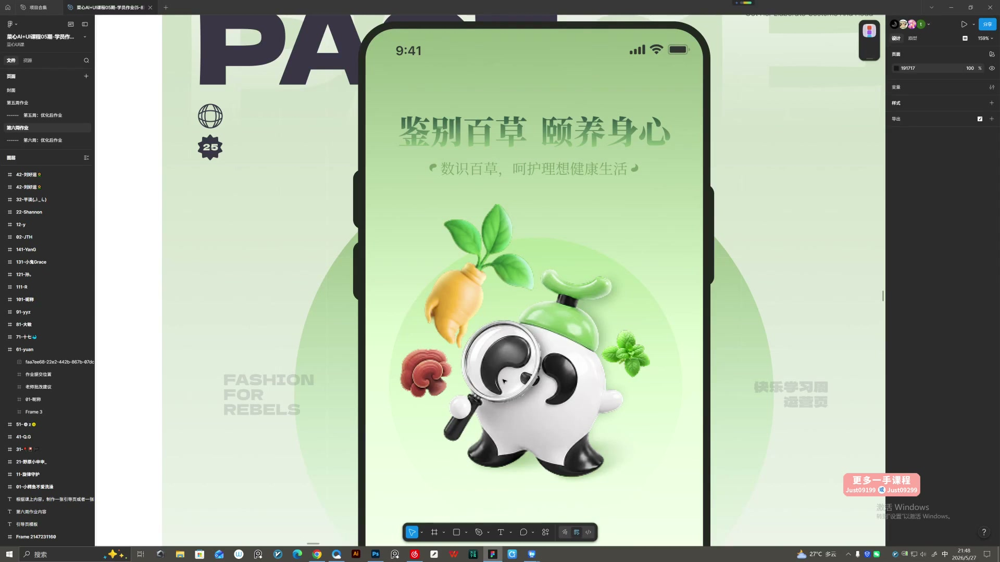

# 22 第六周作业点评｜运营画面的焦点与明暗

> **核心：先判断画面是否有焦点，再检查素材是否统一、信息是否清楚。**

原视频：22第六周作业点评(1-150)    .mp4 ｜ 时长：03:25:40

## 必须掌握

- 先突出主体；衬托底板、背景和辅助元素太强时，降低颜色和明暗强度。
- 主标题与副标题拉开大小，按钮安排在后续操作层，避免与插图同时抢第一。
- 投影统一光源，近处实、远处虚；边缘光、地面反光让主体与环境发生联系。
- 摆元素要么重叠、要么分开，避免边缘刚好相切。
- 彩色与灰度并排查：主体应从背景中分离；最后补细节，不靠继续堆素材补完整度。

## 直接照做

整页看焦点 → 灰度看明暗 → 查素材融合 → 查标题与按钮 → 删减或精修。

## 关键画面

### 01:26:30｜彩色与灰度对照

比较去色后主体与背景的分离程度。

### 01:41:30｜标题与主形象的主次

检查标题、插图和按钮是否形成明确阅读顺序。

### 01:51:30｜主题元素的组合

辅助素材应共同说明主题，而非各自展示。
