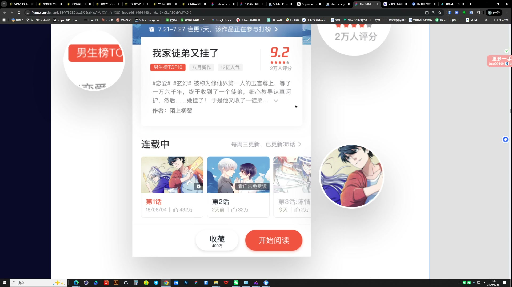
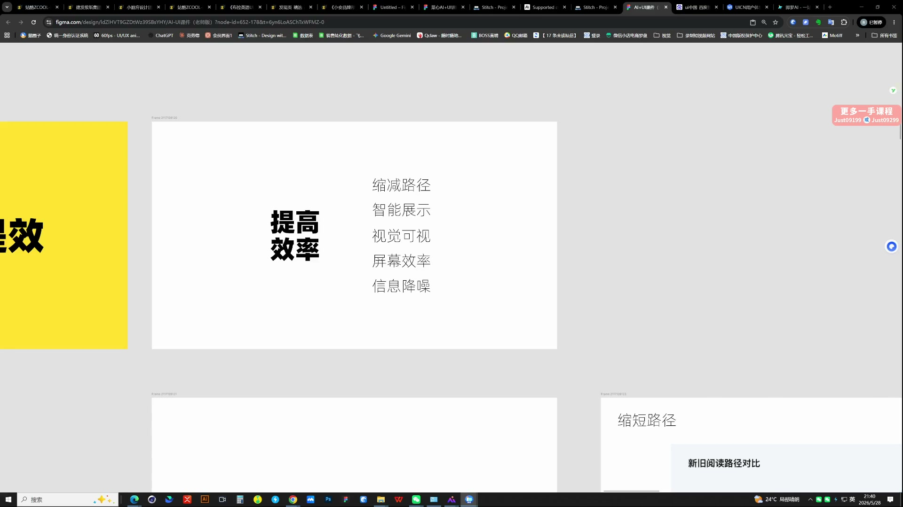
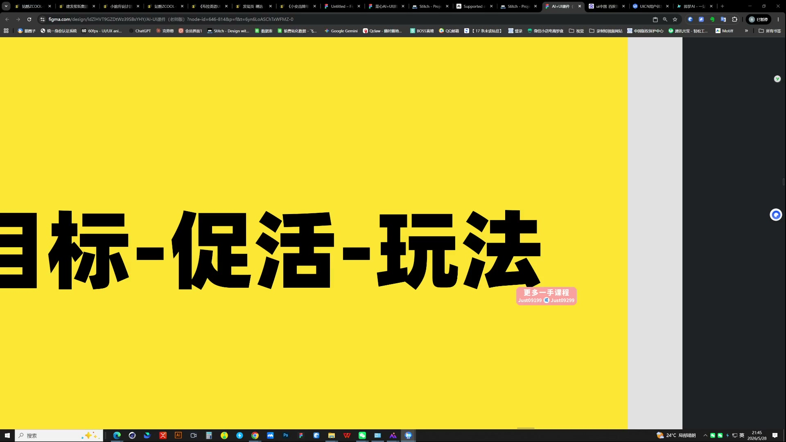

# 23 非视觉化作品包装

> **核心：把界面改动讲成有证据的设计决策，而不是罗列做了哪些页面。**

原视频：23非视觉化作品包装（包含作业布置）    .mp4 ｜ 时长：03:00:05

## 必须掌握

- 每项优化给出改前、改后与具体理由；只写“提高体验、更好看”无法证明设计价值。
- 提效五方向：缩短路径（少步骤）、智能展示（自动给出所需信息）、视觉可视化（更快读懂）、提高屏效（同面积承载有效信息）、信息降噪（减干扰）。
- 例：本来需要重新下单，改为在现有订单追加；说明少了哪个步骤，而非只说“更便捷”。
- 包装参考先找高质量作品，用AI生成版式探索；黑白灰加单色控制整体，再自己落地排版。
- 目标、促活与玩法形成因果关系；放大关键模块，让读者看到改动证据。

## 直接照做

明确目标 → 指出问题 → 展示前后 → 解释决策 → 说明预期效果与验证方式。

## 关键画面

### 01:36:30｜关键模块的细节展示

具体展示信息组织的变化，辅助设计理由。

### 01:41:30｜效率提升的拆解方向

把优化落到路径、信息展示与操作效率。

### 01:46:30｜目标、促活与玩法

说明每个设计动作怎样服务于目标。
