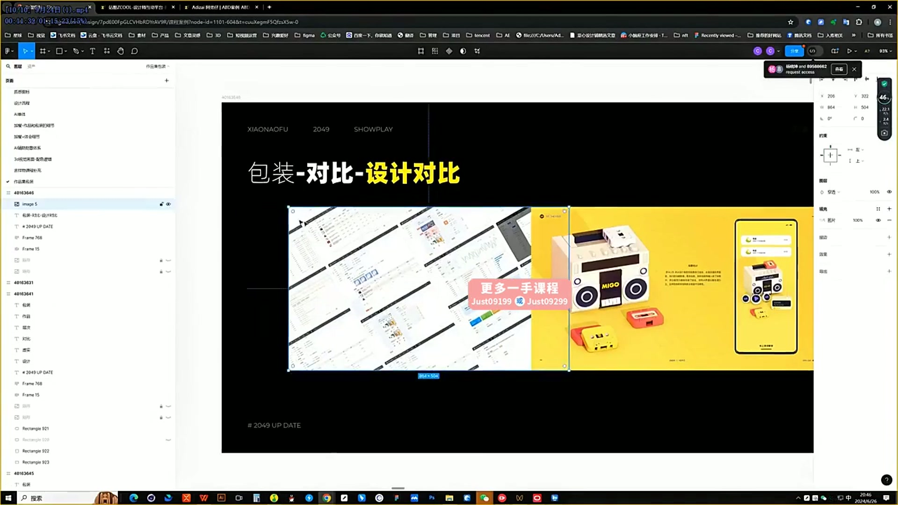
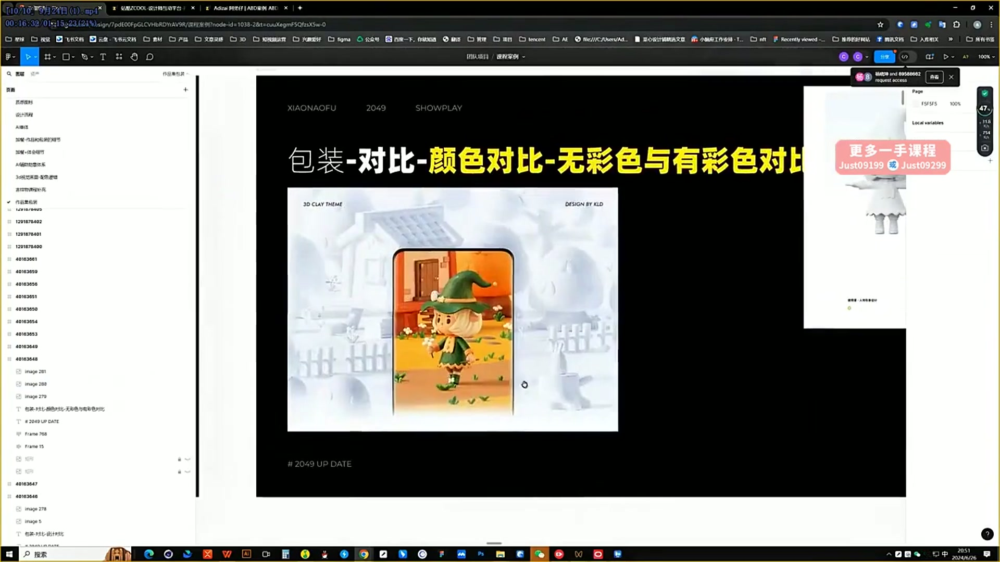
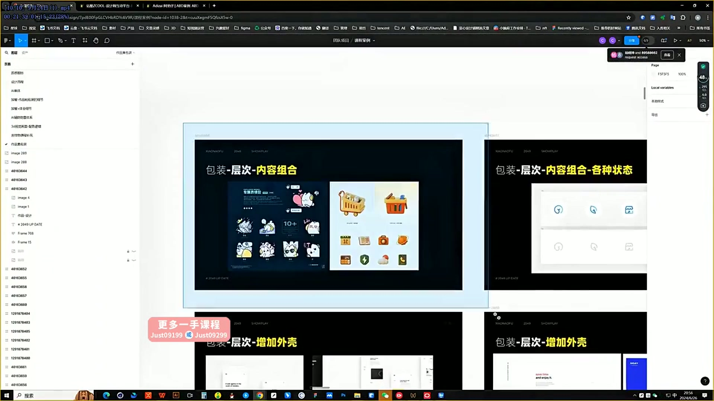

# 24 视觉类作品包装技巧

> **核心：用对比、层次和组合放大作品价值；新增元素必须加分。**

原视频：24视觉类作品包装技巧（精剪录播）    .mp4 ｜ 时长：01:15:25

## 必须掌握

- 先把作品本体做到精致，再包装；作品兼顾设计成果与理念、规范、过程等内容。
- 设计对比：界面旁放大关键插图、图标或组件，让读者看见亮点。
- 颜色对比：用无彩色与有彩色组织焦点，减少无关颜色。
- 大小、平面与透视也能产生对比；表现最好的细节可以放大展示。
- 层次可来自内容组合、不同状态与外壳；每加一项都检查是否提升表达，否则删掉。

## 直接照做

挑亮点 → 选对比方式 → 组织层次 → 补必要细节 → 删减无效装饰。

## 关键画面

### 00:11:30｜界面与亮点设计的对比

把精致的插图和组件从界面中提取、放大，突出优势。

### 00:16:30｜有彩与无彩的对比

让作品成为焦点，同时保证整体环境协调。

### 00:21:30｜内容、状态与外壳的层次

区分有信息价值的层次与纯装饰。
