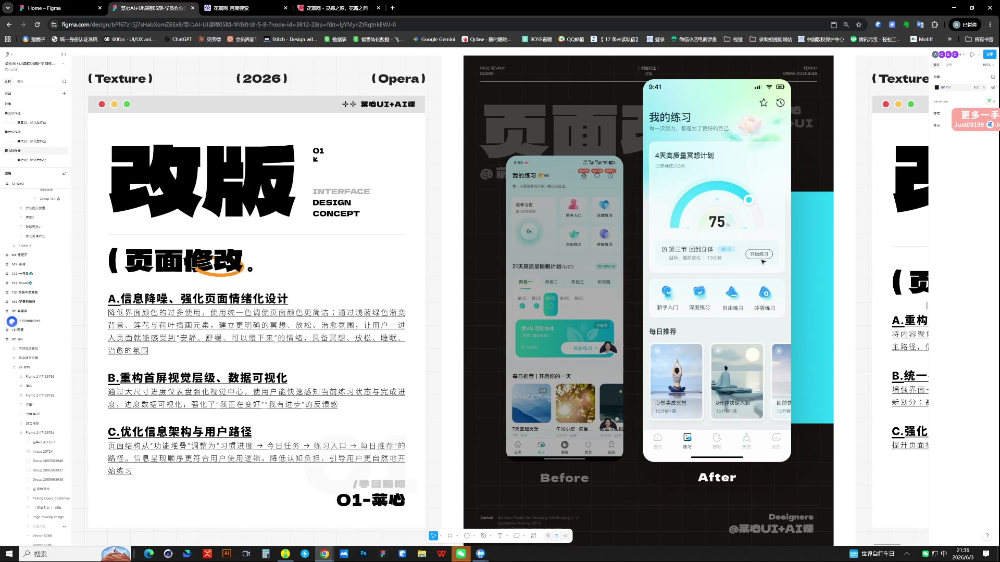
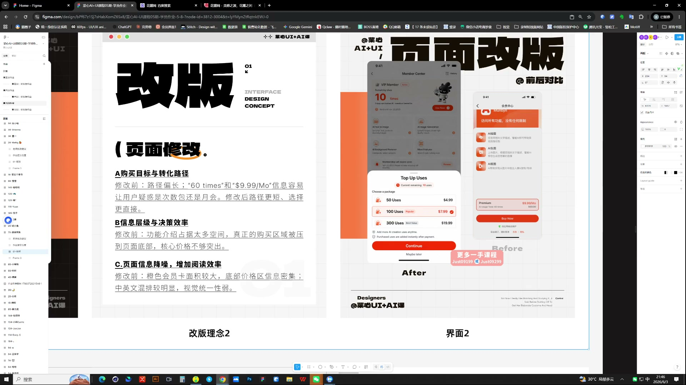
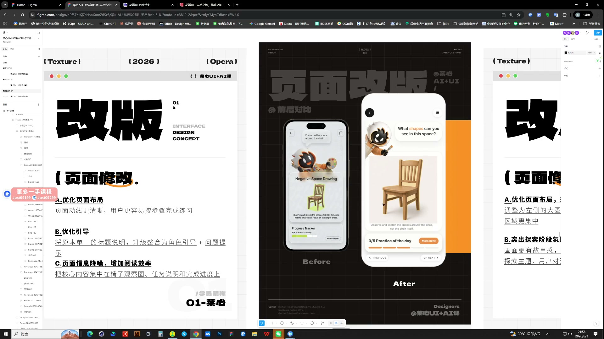

# 25 第七周作业点评｜改版表达与作品包装

> **核心：改动可以小，但理由要准确、前后证据真实。**

原视频：25第七周作业点评(1-150)    .mp4 ｜ 时长：03:21:09

## 必须掌握

- 真实原版与改版按同一任务、同一状态比较；不要把原版刻意变成缺信息的黑白交互稿来衬托结果。
- 保留页面核心任务，不为视觉好看随意删除功能，或新增大量功能后仍称“小优化”。
- 每次找具体小点：路径缩短、信息分组、状态更清楚；说明必须指向看得见的变化。
- 颜色要遵守业务语义，警示等状态不能只为配色舒服随意替换。
- 统一比较尺度，关键变化再放大；把字号、间距、卡片与背景对比等基础问题先解决。

## 直接照做

挑关键改动 → 配前后对照 → 给每项改动写理由 → 放大证据 → 查文字与画面是否对应。

## 关键画面

### 01:36:30｜设计理由与前后对照

每一项说明都要指向页面上的具体变化。

### 01:46:30｜信息结构与视觉语言的分项说明

分清优化了结构、颜色还是组件，避免笼统形容。

### 01:56:30｜前后对照中的功能模块

保持比较条件一致，让人容易发现改善。
