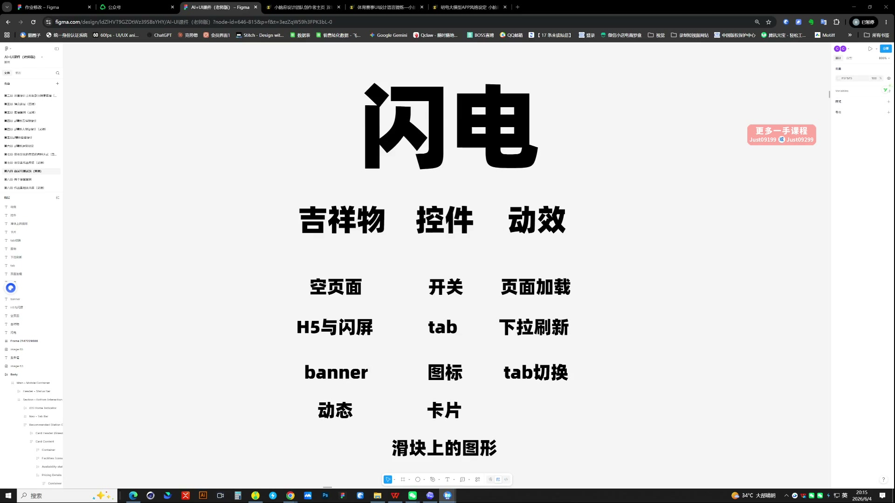
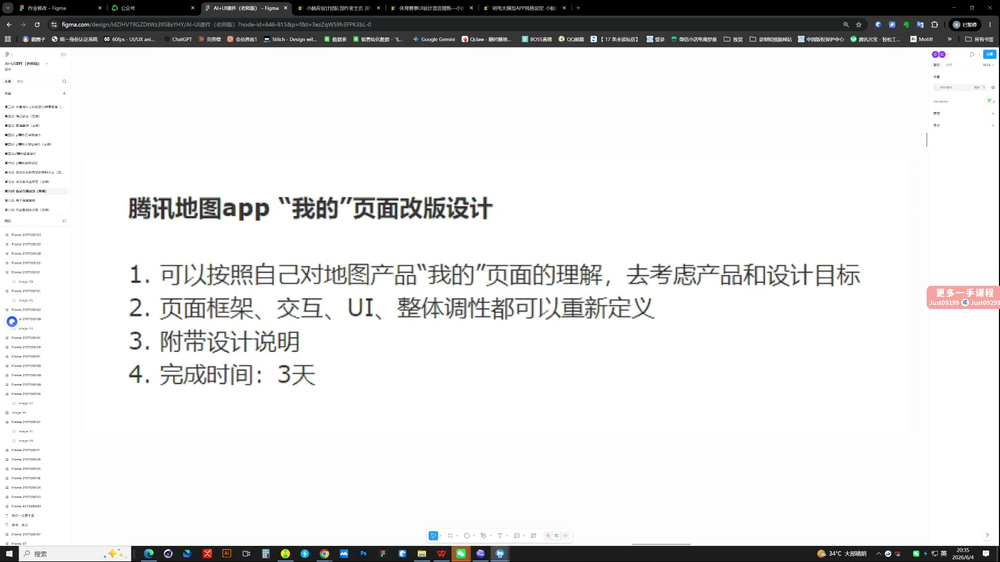
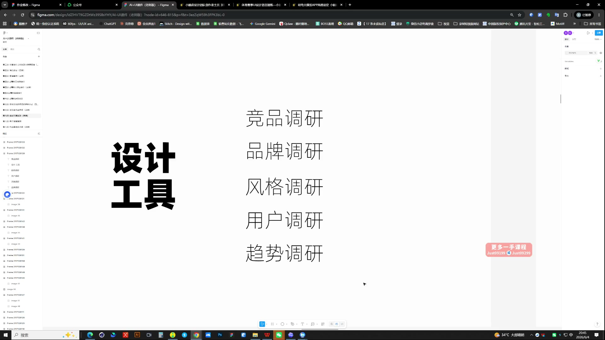

# 26 AI辅助笔试题与表达

> **核心：测试题先保证基础美感，再用一两处亮点与完整逻辑展示能力。**

原视频：26AI辅助笔试题与表达    .mp4 ｜ 时长：02:54:52

## 必须掌握

- 用“点→线→面”检查方案：做精一个元素，延展成体系，再补其他维度，避免只有孤立亮点。
- 品牌符号可以同时贯穿图形、IP、控件和动效，各维度仍要适合实际场景。
- 竞品、品牌、风格、用户、趋势五类调研按问题选一两类，把调研发现转成设计决策。
- 笔试先读清产品目标、页面任务、可改范围与期限，再开始出图。
- 空页面、开关、加载、刷新、Tab等细节体现完整性；只展示一个加载动效还不够。
- 先有好的结果，再展示过程：放大一两处亮点与依据，讲为什么这样做，避免只报工具或堆方法论。
- B端方案重点讲体验如何落地，以及工具、组件如何提高效率。

## 直接照做

拆题 → 定目标 → 有问题地调研 → 做方案 → 补关键状态与细节 → 组织说明。

## 关键画面

### 00:16:30｜设计能力的多个维度

通过形象、控件与动效展示方案完整性。

### 00:36:30｜改版笔试题的要求

先读清产品与设计目标、可改范围、说明要求和期限。

### 00:46:30｜五种调研方向

按问题选调研，不把资料收集本身当成果。
