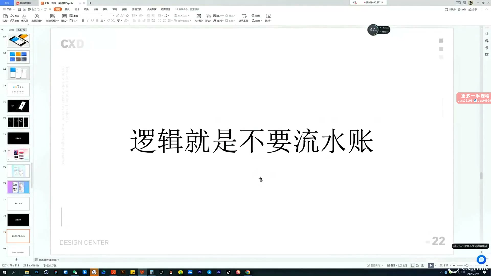
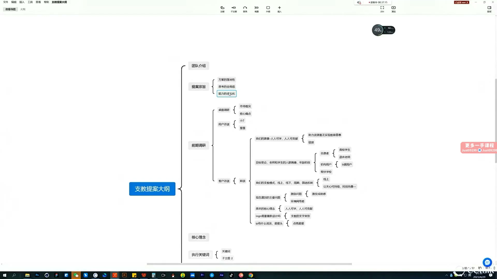
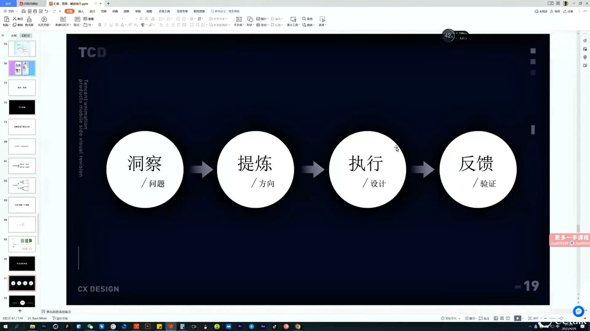

# 27 作品集结构及阐述思路

> **核心：用问题与决策组织作品集，用证据讲清楚自己的价值。**

原视频：27作品集结构及阐述思路（精剪录播）    .mp4 ｜ 时长：01:30:01

## 必须掌握

- 作品集先建立吸引力；面试还需要解释设计逻辑、思考与决策，单独准备讲述。
- 图标足够精致时可放前面；通常先质感，再面性、线性，不能成为亮点时就别勉强。
- 首个主项目展示深度：品牌与图形体系、IP、等级、活动视觉等要与真实界面关联。
- 后续辅助项目展示不同产品与能力，避免与主项目重复；每部分都有明确目的。
- 项目阐述用：洞察问题 → 提炼方向 → 执行设计 → 反馈验证；每一步展示依据与产出，避免流水账。
- 调研工具必须带来结论：用户画像、产品定位、品牌基因或趋势 → 设计关键词 → 对应视觉执行；反馈用真实数据或评价。

## 直接照做

开头与介绍 → 图标亮点 → 首个主项目（深度）→ 辅助项目（广度）→ 按问题与决策练习阐述。

## 关键画面

### 00:26:30｜避免流水账的表达原则

结构围绕问题和关键决策展开，而非制作顺序。

### 00:36:30｜先梳理作品集大纲

把能力和项目证据关联起来，再排展示内容。

### 00:51:30｜项目阐述的四步逻辑

洞察、提炼、执行与反馈构成可讲述的设计链条。
